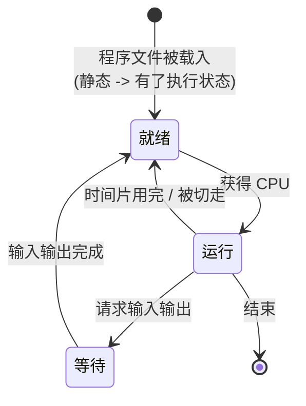
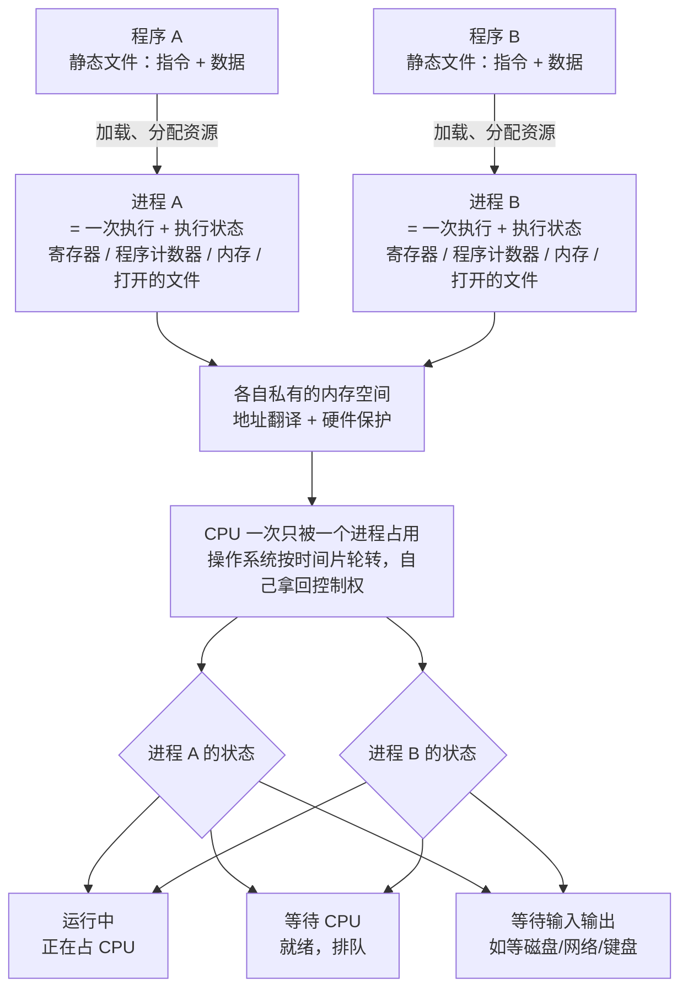
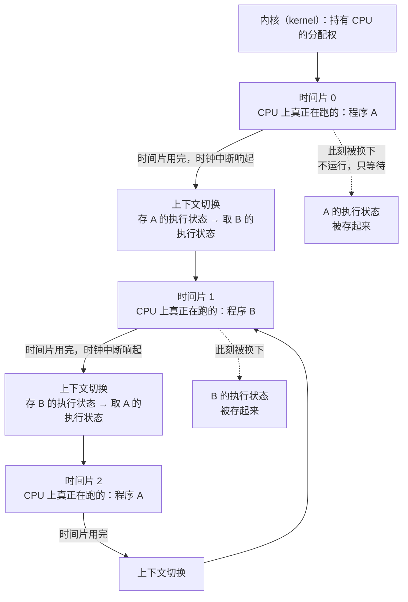
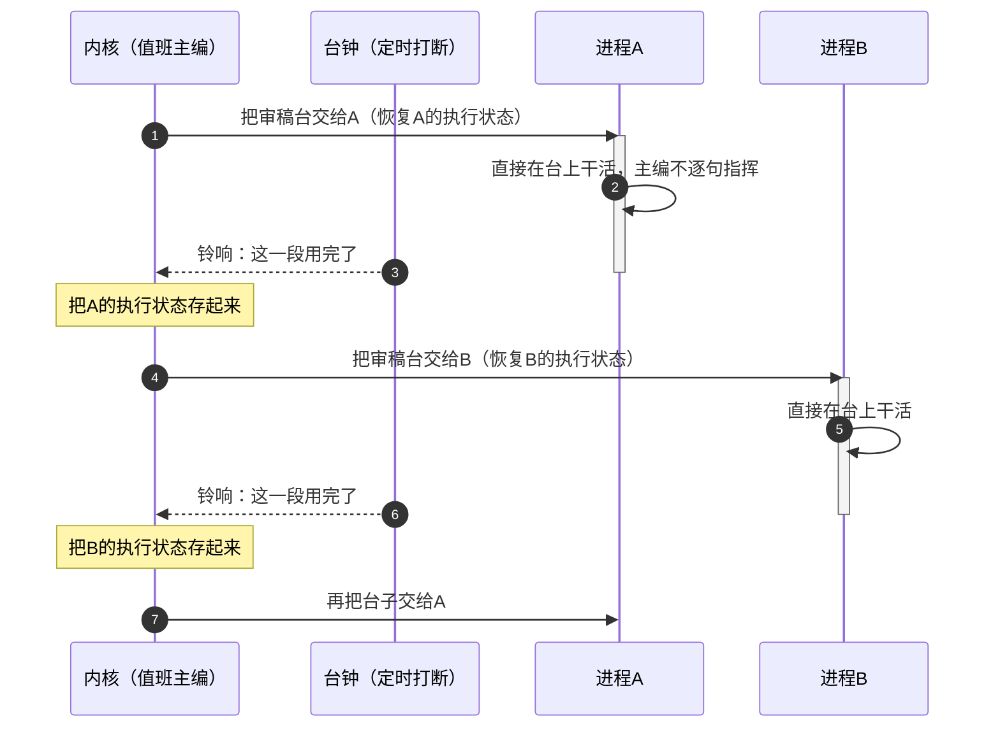
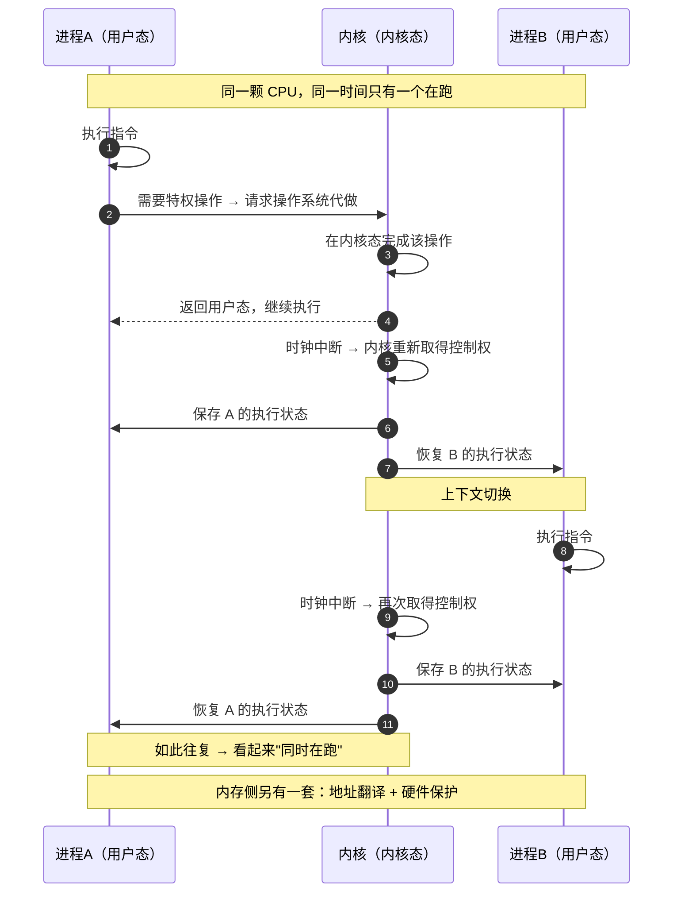
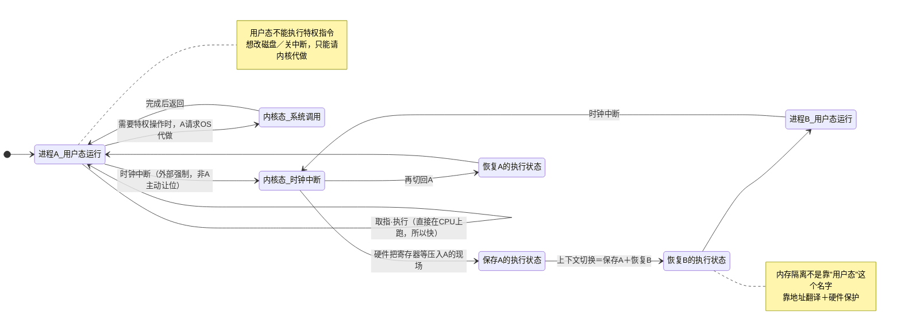
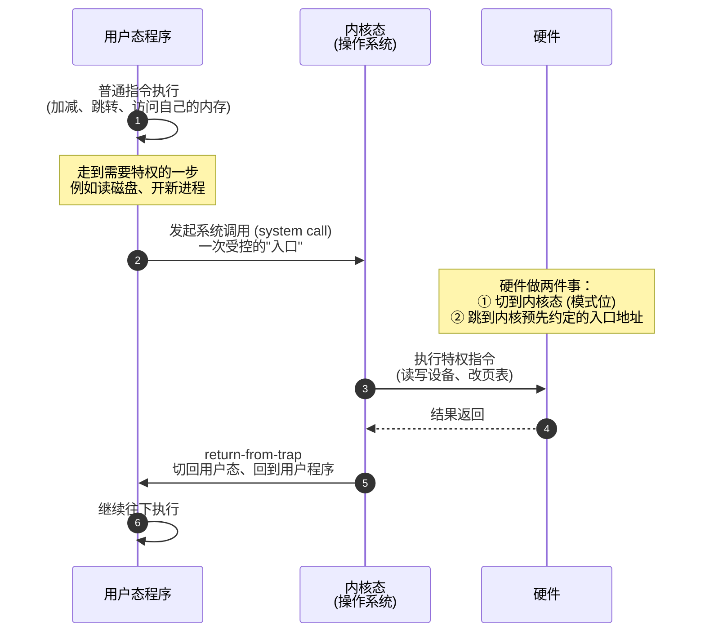
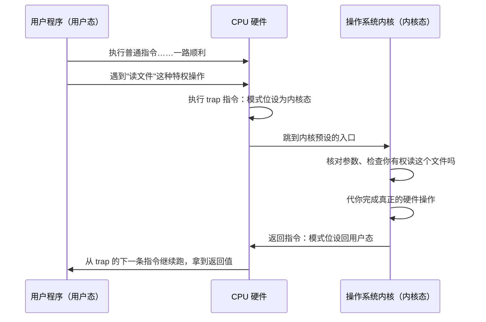
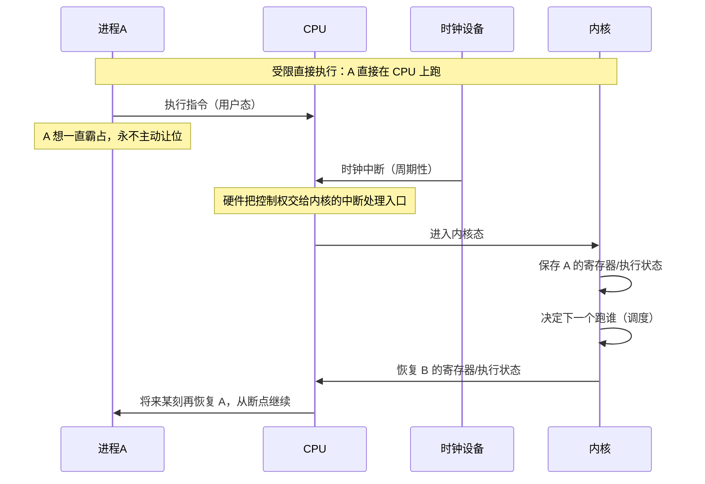
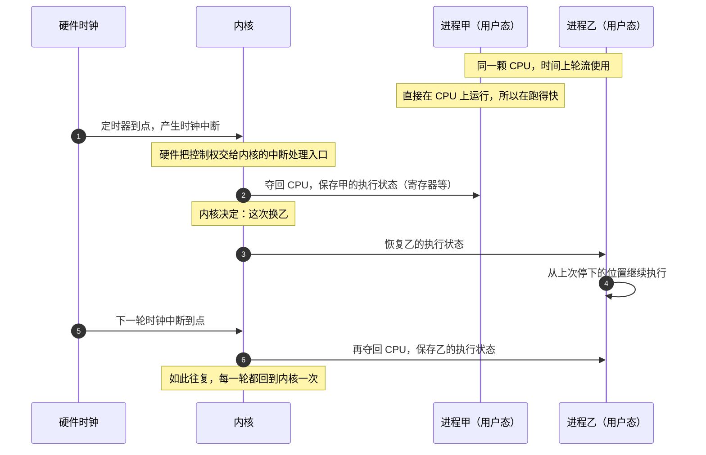

# 取证报告 · 「模型到底能不能把白板写好」可测量验证（PoC）

> **日期**：2026-09-24　**执行**：子代理（实验执行者）
> **产出目录**：`开源线/DSH定制/poc_白板可写性/`　**本报告**：`开源线/DSH定制/取证_白板可写性PoC_2026-09-24.md`
> **纪律**：判据先写死再跑；`code/plugins/**`、`code/classrooms/**`、`~/SocraticNovel-wt/` 全程只读；任何 profile 未装/卸插件；`web`／桌面 profile 零接触；无 git 操作。

## 0. 一句话结论

**能写好——但前提是必须显式给出白板工具/输出契约。** 本路由（`me/cline-pass/deepseek-v4.1-flash`，见 §1.3）实测：

- **A 组（只说「需要时把白板画出来」，不给工具、不给格式）：10/10 一次都没产出可渲染的白板产物**——全部改用 **ASCII 等宽示意图**（``` 围栏 + 制表符），且图里机制环节稀少。
- **B 组（显式 `draw_whiteboard` 契约 + 动词优先描述）：mermaid 10/10 解析并渲染成功，excalidraw 10/10 JSON 合法且渲染成功。**
- 可用率（5 项全过）：**A 组 0/10，B1（mermaid）8/10，B2（excalidraw）6/10**。
- 主要失败模式：A＝格式不遵守；B2＝留白式敷衍（2/10）、图内标签与教材口径冲突（1/10）。
- 🔴 **本路由下 n=30 的实测结果，不得外推到"所有模型"、不得当普遍规律。** 详见 §6 边界。

---

## 1. 实验设计（跑之前写死）

### 1.1 被测对象：真实教室 cs-os 第 1 讲（不自编教材）

| 材料 | 路径 | 用途 |
|---|---|---|
| 知识点判据 | `开源线/DSH定制/code/classrooms/cs-os/knowledge_points.md` §第 1 讲 | 取 **KP-1.1 ~ KP-1.5 共 5 条**（逐字进 prompt） |
| 教材正文 | `.../materials/ch01.md` | 取「本讲核心事实（知识锚）」6 条（第 55–63 行）逐字进 prompt |
| 题眼 | 同上「本讲要回答的核心疑问」 | 「两个程序同时跑，为什么不互相捣乱」 |

**5 条知识点**（逐字抄自 knowledge_points.md:11–15）：

| 编号 | 标题 | 判据 |
|---|---|---|
| KP-1.1 | 进程是什么 | 能区分静态程序文件与带有执行状态的进程，并知道进程也可能等待 CPU 或输入输出。 |
| KP-1.2 | 虚拟化 CPU 的目标 | 能解释多个进程怎样通过时间共享获得执行机会，以及“仿佛独占”的简化说法是什么意思。 |
| KP-1.3 | 受限直接执行 | 能解释程序直接在 CPU 上运行为什么快、操作系统为什么仍需保持控制。 |
| KP-1.4 | 用户态与内核态 | 能解释普通程序为什么不能随意执行特权操作，以及系统调用如何跨越这个边界。 |
| KP-1.5 | 时钟中断的作用 | 能解释定时器中断为何让操作系统不必等待程序主动让位，同时知道它不是返回内核的唯一途径。 |

> 🔴 **与任务书的偏差（据实记录）**：任务书写「取第 1 讲 **6–8 个**知识点」，但 `knowledge_points.md` 第 1 讲**只有 5 条**（KP-1.1~1.5，文件第 100 行统计表亦写「1 ｜ 5」）。→ 按"真实教室为准"取满 5 条，靠**产物维度**（P1 mermaid / P2 excalidraw）凑足样本量。

### 1.2 两组 + 两种产物

| 组 | prompt 里关于"画白板"的那一句（两组**唯一差异**） |
|---|---|
| **A｜自由输出** | `需要时把白板画出来。`（不给工具、不给格式、不给示例） |
| **B1｜显式契约（P1 mermaid）** | `【白板工具】draw_whiteboard —— 把白板内容画出来。调用方式：输出一个语言标记为 mermaid 的代码块…（sequenceDiagram / stateDiagram-v2 / flowchart 三选一）。直接把图完整画出来，不要用文字描述代替，不要留空。` |
| **B2｜显式契约（P2 excalidraw）** | `【白板工具】draw_whiteboard —— 把白板场景画出来。调用方式：输出一个语言标记为 json 的代码块，内容是一个 excalidraw 场景：顶层含 "type":"excalidraw"、"version"、"elements"、"appState"、"files"；elements 里每个元素至少带 id/type/x/y/width/height/angle/…/groupIds。直接把场景完整画出来，不要用文字描述代替，不要留空。` |

**两组共同前缀（逐字，见 `raw/<id>.prompt.txt`）**：同一段知识锚 + 同一句学生提问 + 同一句输出纪律（`只输出你的回复正文，不要调用工具、不要读写任何文件。`）。

> **为什么 B 组用"输出契约"而不是真注册一个工具**：本实验不许装/卸任何 profile 的插件，`socratic-headless` 现有引擎只注册了 `classroom_status`／`classroom_list`（`code/plugins/socratic-engine/index.mjs:197`、`lib/discovery.mjs:706`），**没有任何白板工具**。任务书允许"或明确的输出契约"，故 B 组用工具卡形式的输出契约。**这恰好就是旧仓库根因②要测的那个变量——"工具描述怎么写"。**

### 1.3 运行通道与模型（诚实标注）

| 项 | 值 |
|---|---|
| 通道 | `dsh --profile socratic-headless "<task>"`（单进程一 turn，`/opt/homebrew/bin/node` 起 `dsh/lib/bin.js`） |
| 路由 | `settings.yaml` 的 `agent-default-model`：**provider `me` ／ model `cline-pass/deepseek-v4.1-flash`** |
| 环境注入 | `socratic-headless` profile 挂 `socratic-engine` + `socratic-test`，教室目录指向 **fixture `test/fixtures/minimal-classroom`**（不是 cs-os）→ 每回合会贴尾注入 `① 只问不答，不直接给结论；② 不抢学生的命名权；③ 最后一英里留给学生自己走完` |
| 并发 | 3 路；单次 8–45 秒；30 次总用时约 3.5 分钟 |

> 🔴 **两个必须说明的边界**：
> ① **该注入是 A/B 两组共有的**，因此 A/B 对比有效；但它**压低了绝对水平**（模型被要求"只问不答"，直接导致 B2 出现 2 例"留白式"白板）。
> ② **实验环境不是冻结的**：实验期间 `code/classrooms/cs-os/AGENTS.md`、`classroom.yaml` 被**另外的工作线**至少改动 2 次（会话中收到两次「This file changed after it was loaded」）。本实验只用 prompt 内嵌的教材文本，不读这些文件，故不受影响——但**复现时环境可能已变**。

### 1.4 判定标准（5 项，先写死）

| # | 判据 | 判定方式 |
|---|---|---|
| 1 | 语法可解析 | mermaid → `mermaid.parse()`（mermaid 11 ESM）是否抛错；excalidraw → `JSON.parse` + 顶层 `type==="excalidraw"` + `elements` 是数组 |
| 2 | 渲染成功且非空 | 真渲染出 SVG 且 `getBBox()` 宽高 > 0，并**落 PNG**（mermaid 用 `mermaid.render`；excalidraw 用官方渲染器 `@excalidraw/utils` 的 `exportToSvg`） |
| 3 | 教学正确性 | 逐条对照 `materials/ch01.md` 的「知识锚」6 条与「类比的边界」 |
| 4 | 可用性（关键结构） | 程序统计**图内容**里出现题眼链条几环（进程与状态／上下文切换／时钟中断／特权边界／地址隔离），≥2 环记 ok；再叠加人工复核 |
| 5 | 失败模式归类 | 语法错／概念错／过度复杂／拒绝或敷衍／格式不遵守 |

### 1.5 样本量与波次

- 矩阵：**5 知识点 × [A×2 + B1×2 + B2×2] = 30 次生成**。
- **先导波**：KP-1.2、KP-1.4 全因子 12 次 → 跑通"生成→抽取→解析→真渲染→落 PNG"全链路后再补满。
- **补满波**：KP-1.1、KP-1.3、KP-1.5 共 18 次。
- **基础设施失败 1 次**：`kp15-B2-r1` 首次 `exit=1`，stderr 末尾逐字 `dsh: PI_AI_ERROR: unexpected EOF`（输出被截断，stdout 仅 1 字节）。→ 备份为 `raw/_重跑备份/`，**重跑一次成功**；下文统计用重跑结果，失败单独计入 §5。

---

## 2. 可用率总表（分子/分母都写出来）

| 判据 | A 组（自由输出） | B1 组（mermaid 契约） | B2 组（excalidraw 契约） |
|---|---|---|---|
| 1 语法可解析 | 0/10（无结构化产物可解析） | **10/10** | **10/10** |
| 2 渲染成功且非空 | 0/10 | **10/10** | **10/10** |
| 3 教学正确性（无冲突） | 10/10 | 10/10 | 9/10 |
| 4 关键结构（图内 ≥2 环） | 4/10 | 8/10 | 7/10 |
| **5 项全过（可用）** | **0/10** | **8/10** | **6/10** |

> **A 组的第 1、2 项记 0 是因为它压根没产出结构化产物**——不是"解析失败"，是"没有东西可解析"。这是**最关键的一条实测事实**，也正是旧仓库 `render_canvas` 那类事故的另一种形态：**模型不是拒绝画，而是用 ASCII 画完就算交差**。

### 2.1 逐条判定明细

| 产物 id | 组 | 形式 | 1 解析 | 2 渲染 | 3 正确 | 4 结构 | 图内链条命中 | 5 失败模式 |
|---|---|---|---|---|---|---|---|---|
| `kp11-A-r1` | A | ascii/文字示意图 | ✗ | ✗ | ✓ | ✓ | 进程与状态·上下文切换 | 格式不遵守：以 ASCII 等宽示意图代替白板产物（无任何可被渲染管线消费的结构化产物） |
| `kp11-A-r2` | A | ascii/文字示意图 | ✗ | ✗ | ✓ | ⚠ | 进程与状态 | 格式不遵守：以 ASCII 等宽示意图代替白板产物（无任何可被渲染管线消费的结构化产物） |
| `kp11-B1-r1` | B1 | mermaid:stateDiagram-v2 | ✓ | ✓ | ✓ | ✓ | 进程与状态·时钟中断 | 无失败 |
| `kp11-B1-r2` | B1 | mermaid:flowchart | ✓ | ✓ | ✓ | ✓ | 进程与状态·时钟中断·地址隔离 | 无失败 |
| `kp11-B2-r1` | B2 | excalidraw | ✓ | ✓ | ✓ | ✓ | 进程与状态·上下文切换 | 无失败 |
| `kp11-B2-r2` | B2 | excalidraw | ✓ | ✓ | ✓ | ✓ | 进程与状态·时钟中断·特权边界·地址隔离 | 无失败 |
| `kp12-A-r1` | A | ascii/文字示意图 | ✗ | ✗ | ✓ | ⚠ | — | 格式不遵守：以 ASCII 等宽示意图代替白板产物（无任何可被渲染管线消费的结构化产物） |
| `kp12-A-r2` | A | ascii/文字示意图 | ✗ | ✗ | ✓ | ⚠ | 进程与状态 | 格式不遵守：以 ASCII 等宽示意图代替白板产物（无任何可被渲染管线消费的结构化产物） |
| `kp12-B1-r1` | B1 | mermaid:flowchart | ✓ | ✓ | ✓ | ✓ | 进程与状态·上下文切换·时钟中断 | 无失败 |
| `kp12-B1-r2` | B1 | mermaid:sequenceDiagram | ✓ | ✓ | ✓ | ✓ | 进程与状态·上下文切换 | 无失败 |
| `kp12-B2-r1` | B2 | excalidraw | ✓ | ✓ | ✓ | ⚠ | — | 无失败 |
| `kp12-B2-r2` | B2 | excalidraw | ✓ | ✓ | ⚠ | ✓ | 进程与状态·特权边界·地址隔离 | 概念错：图内标签与教材知识锚冲突（内存隔离被归给用户态） |
| `kp13-A-r1` | A | ascii/文字示意图 | ✗ | ✗ | ✓ | ⚠ | — | 格式不遵守：以 ASCII 等宽示意图代替白板产物（无任何可被渲染管线消费的结构化产物） |
| `kp13-A-r2` | A | ascii/文字示意图 | ✗ | ✗ | ✓ | ⚠ | — | 格式不遵守：以 ASCII 等宽示意图代替白板产物（无任何可被渲染管线消费的结构化产物） |
| `kp13-B1-r1` | B1 | mermaid:sequenceDiagram | ✓ | ✓ | ✓ | ✓ | 进程与状态·上下文切换·时钟中断·特权边界·地址隔离 | 无失败 |
| `kp13-B1-r2` | B1 | mermaid:stateDiagram-v2 | ✓ | ✓ | ✓ | ⚠ | 进程与状态·上下文切换·时钟中断·特权边界·地址隔离 | 无失败 |
| `kp13-B2-r1` | B2 | excalidraw | ✓ | ✓ | ✓ | ✓ | 时钟中断·特权边界·地址隔离 | 无失败 |
| `kp13-B2-r2` | B2 | excalidraw | ✓ | ✓ | ✓ | ⚠ | 进程与状态 | 无失败 |
| `kp14-A-r1` | A | ascii/文字示意图 | ✗ | ✗ | ✓ | ✓ | 进程与状态·特权边界 | 格式不遵守：以 ASCII 等宽示意图代替白板产物（无任何可被渲染管线消费的结构化产物） |
| `kp14-A-r2` | A | ascii/文字示意图 | ✗ | ✗ | ✓ | ✓ | 进程与状态·时钟中断·特权边界·地址隔离 | 格式不遵守：以 ASCII 等宽示意图代替白板产物（无任何可被渲染管线消费的结构化产物） |
| `kp14-B1-r1` | B1 | mermaid:sequenceDiagram | ✓ | ✓ | ✓ | ✓ | 进程与状态·特权边界·地址隔离 | 无失败 |
| `kp14-B1-r2` | B1 | mermaid:sequenceDiagram | ✓ | ✓ | ✓ | ⚠ | 特权边界 | 无失败 |
| `kp14-B2-r1` | B2 | excalidraw | ✓ | ✓ | ✓ | ⚠ | 特权边界 | 无失败 |
| `kp14-B2-r2` | B2 | excalidraw | ✓ | ✓ | ✓ | ✓ | 进程与状态·时钟中断·特权边界·地址隔离 | 无失败 |
| `kp15-A-r1` | A | ascii/文字示意图 | ✗ | ✗ | ✓ | ⚠ | 时钟中断 | 格式不遵守：以 ASCII 等宽示意图代替白板产物（无任何可被渲染管线消费的结构化产物） |
| `kp15-A-r2` | A | ascii/文字示意图 | ✗ | ✗ | ✓ | ✓ | 上下文切换·时钟中断 | 格式不遵守：以 ASCII 等宽示意图代替白板产物（无任何可被渲染管线消费的结构化产物） |
| `kp15-B1-r1` | B1 | mermaid:sequenceDiagram | ✓ | ✓ | ✓ | ✓ | 进程与状态·时钟中断·特权边界 | 无失败 |
| `kp15-B1-r2` | B1 | mermaid:sequenceDiagram | ✓ | ✓ | ✓ | ✓ | 进程与状态·上下文切换·时钟中断·特权边界 | 无失败 |
| `kp15-B2-r1` | B2 | excalidraw | ✓ | ✓ | ✓ | ✓ | 进程与状态·上下文切换·时钟中断·特权边界·地址隔离 | 无失败 |
| `kp15-B2-r2` | B2 | excalidraw | ✓ | ✓ | ✓ | ✓ | 进程与状态·时钟中断·地址隔离 | 无失败 |

### 2.2 图内关键链条命中率（只看图内容，A/B 同口径）

| 链条环节 | A 组 | B1 | B2 |
|---|---|---|---|
| 进程与状态 | 5/10 | 9/10 | 7/10 |
| 上下文切换 | 2/10 | 5/10 | 2/10 |
| 时钟中断 | 3/10 | 7/10 | 5/10 |
| 特权边界 | 2/10 | 6/10 | 6/10 |
| 地址隔离 | 1/10 | 4/10 | 6/10 |
| **平均命中环数** | **1.30** | **3.10** | **2.60** |

> 口径说明：A 组的"图"= 无语言标记围栏里的等宽示意图（不含正文论述）；B1 = mermaid 源码；B2 = 场景里的 text 元素。**只判图，不判正文**，否则 A 组会把长篇论述算进去、比较失真。

---

## 3. 原始证据（逐条落盘，逐字引用）

> 🔴 **全部原始输出已全文落盘**，不是转述：每次生成的完整 stdout 在 `poc_白板可写性/raw/<id>.out.txt`，完整 stderr（含模型 reasoning）在 `raw/<id>.err.txt`，实际发出的 prompt 在 `raw/<id>.prompt.txt`。
> 本节把**产物本身**（A 组的 ASCII 图所在全文、B1 的 mermaid 源码、B2 的文本元素全量）逐字抄出来，避免转述失真。

### 3.1 KP-1.1 · 进程是什么

> 判据：能区分静态程序文件与带有执行状态的进程，并知道进程也可能等待 CPU 或输入输出。

#### `kp11-A-r1`　A 组·自由输出　rep 1

**判定**：1 ✗｜2 ✗｜3 ✓｜4 ✓｜失败模式：格式不遵守：以 ASCII 等宽示意图代替白板产物（无任何可被渲染管线消费的结构化产物）

**产物形式**：`ascii/文字示意图`；围栏语言标记 ["∅"]；无语言标记围栏 1 个（其中含示意图 true 个）。**全文 1577 字，逐字如下**：

````text
你这个问法里藏着一个假设：**“同时跑”**。先把这个词拆开看——不然后面的答案都对不上问题。

## 先看我画的白板

``​`
时间轴（一个 CPU）─────────────────────────────────────►

        ┌── A 在跑 ──┐  ┌── 保存 A 状态 ──┐  ┌── B 在跑 ──┐
CPU:    │ 执行 A 的  │  │ 内核把 A 的    │  │ 执行 B 的  │  … 来回切
        │ 指令…      │  │ 寄存器存到 A 的│  │ 指令…      │
        └────────────┘  │ 进程记录里     │  └────────────┘
                        └────────────────┘
        ▲                                    ▲
   只有此刻，CPU 上的指令来自唯一一个程序；另一个在等

A 的进程记录                     B 的进程记录
┌──────────────────┐            ┌──────────────────┐
│ PC / 栈指针 / 寄存器 │            │ PC / 栈指针 / 寄存器 │
│ 内存区、打开的文件…  │            │ 内存区、打开的文件…  │
└──────────────────┘            └──────────────────┘
        （还有第三种状态：在等 CPU，或在等输入输出）
``​`

## 关键区分：静态的文件 vs 会跑的进程

你硬盘上那两个程序文件，是**静态的**——就是躺在磁盘上的一堆字节，谁也没在跑。真正在机器里“活着”的，是**进程**：一个程序的一次执行，加上它此刻的执行状态。白板上那两个“进程记录”框就是它——**寄存器（register）里的内容、程序计数器（PC，指向下一条指令）、栈指针、它占的内存**，这些一起构成“它跑到哪儿了”。

所以你说的“两个程序”，在操作系统眼里其实是**两个进程**，各自带着自己的一套执行状态。交替的时候，一个的状态被完整存下来，另一个的状态被恢复回去——两边各自接着上次的断点往下走，谁也看不出中间被暂停过。这个“存 + 恢复”的动作，我们这一讲后面会专门给它一个名字。

## 所以“不互相捣乱”，前半个答案是这样

那个“同时”，其实不是同一瞬间两条指令一起进 CPU，而是**切换得足够快**：一会儿跑 A，一会儿跑 B，轮流给机会。既然每个进程有自己的状态记录，切换时把 A 的状态收好、把 B 的状态摆上，**A 就不会把 B 算到一半的中间结果冲掉**。

⚠️ 不过这只回答了一半。你问的“捣乱”还有另一半：**就算状态各自存好了，A 凭什么不能去翻 B 的内存？** 这一半不是靠“轮流”解决的，也不是靠“用户态/内核态”这两个名字能解释的——它靠的是内存那一侧的机制，我们会单独拿一讲来讲。今天先把它记成一句预告：**“进程各自独立”这件事，光有时分共享还不够。**

## 留给你自己想一个问题

假如两个进程都各自“保存了寄存器状态”，那么设想这样一个场景：

> 进程 A 刚算到一半，寄存器里正放着 `x = 5`。这时切到进程 B，B 也往那个**同一块物理寄存器**里写了 `x = 99`。等再切回 A 的时候——

A 接着往下算，它会用到哪个值？为了让它用到的还是自己的那个 5，中间必须发生一件什么事？**把你的说法讲出来**，我们再对一下——这正好就是“保存/恢复执行状态”到底在保存什么。

````

#### `kp11-A-r2`　A 组·自由输出　rep 2

**判定**：1 ✗｜2 ✗｜3 ✓｜4 ⚠｜失败模式：格式不遵守：以 ASCII 等宽示意图代替白板产物（无任何可被渲染管线消费的结构化产物）

**产物形式**：`ascii/文字示意图`；围栏语言标记 ["∅","∅"]；无语言标记围栏 2 个（其中含示意图 true 个）。**全文 1346 字，逐字如下**：

````text
先把黑板分成左右两半，左半边写「磁盘上的东西」，右半边写「跑起来之后的东西」。

``​`
        磁盘 / 静态                          内存 / 正在跑
   ┌──────────────────────┐          ┌──────────────────────┐
   │  hello              │          │  hello 的这份执行      │
   │  ─────────────      │          │  ─────────────        │
   │  指令们（一条条）      │   ？     │  指令们（同一批）      │
   │  常量、字符串         │  ────▶   │  PC（下一条执行到哪）   │
   │                      │          │  寄存器（算到一半的值） │
   │  它自己是不会动的      │          │  栈、堆               │
   └──────────────────────┘          └──────────────────────┘
         程序（程序文件）                    进程（process）
``​`

左边那些指令，你放一年它也不会自己执行；右边这一坨，才是「正在跑」的东西。

现在同一个 hello，开两个窗口各跑一次：

``​`
   磁盘上的 hello（只有一份，谁也没抢谁的）

        │                      │
        ▼                      ▼
  ┌───────────────┐      ┌───────────────┐
  │  进程 A        │      │  进程 B        │
  │  PC 在第 12 条 │      │  PC 在第 3 条  │
  │  寄存器里有它的值│      │  寄存器里有它的值│
  │  自己的栈、自己的堆│    │  自己的栈、自己的堆│
  └───────────────┘      └───────────────┘
``​`

注意看：**连「执行到第几条」都各记各的**。A 跑到第 12 条的时候，B 可能才第 3 条。你的问题——「为什么不互相捣乱」——先别急着回答，我们把「捣乱」拆成两种可能，这决定了后面几讲要解决两件不同的事：

- 一种是 **A 和 B 各自的寄存器和栈互相踩**（内存被别的进程改写）；
- 一种是 **A 偷偷干了一件它本来没资格干的事**（比如直接去碰硬盘、关掉时钟）。

那么先问你一个问题，只用上面那张图回答：

**如果磁盘上的 hello 只有一份、从没被复制过，那为什么两个窗口跑起来，A 和 B 的 PC 可以停在不同位置、寄存器里装不同的值？换句话说，跑起来的那「多出来的一份」到底是什么东西？它又是从哪来的？**

（想完这个，下一个问题就落到「谁给的资格」上了。）

````

#### `kp11-B1-r1`　B1 组·mermaid　rep 1

**判定**：1 ✓｜2 ✓｜3 ✓｜4 ✓｜失败模式：无失败

**数字**：图类型 `stateDiagram-v2`；有效行 7；渲染节点 5；标签元素 18（`<text>` 0 ＋ foreignObject 18）；边 6；SVG 31343 字节；**bbox 307×380**；PNG → `png/kp11-B1-r1.png`（已落盘）

**mermaid 源码（逐字）**：



#### `kp11-B1-r2`　B1 组·mermaid　rep 2

**判定**：1 ✓｜2 ✓｜3 ✓｜4 ✓｜失败模式：无失败

**数字**：图类型 `flowchart`；有效行 16；渲染节点 11；标签元素 37（`<text>` 0 ＋ foreignObject 37）；边 0；SVG 28208 字节；**bbox 607×889**；PNG → `png/kp11-B1-r2.png`（已落盘）

**mermaid 源码（逐字）**：



#### `kp11-B2-r1`　B2 组·excalidraw　rep 1

**判定**：1 ✓｜2 ✓｜3 ✓｜4 ✓｜失败模式：无失败

**数字**：JSON 合法 true；顶层 type=`excalidraw`；`version`=2；elements **30** 个（text 18／矩形等形状 12／箭头线 0）；必需字段缺失统计 `{}`；非法 type []；`appState` 有（5 键）；`files` 有；背景色 `#ffffff`；isDeleted=0；渲染 bbox **880×722**；PNG → `png/kp11-B2-r1.png`（已落盘）

**场景内全部文本元素（逐字）**：

```text
同一颗 CPU 上，两个程序怎么轮流跑
① 两份程序文件都只是躺在磁盘上的静态文本    ② 谁上 CPU，谁就得先有自己的执行状态（盒子）
浅蓝 = 进程 A 的状态盒子      绿色 = 进程 B 的状态盒子
程序文件 a.out（静态）
磁盘上一堆指令和数据
没有"跑到哪儿了"这回事
进程 A 盒子
PC = 0x4012（跑到哪条指令）
寄存器…    状态：RUNNING
内存：A 自己的地盘
程序文件 b.out（静态）
磁盘上一堆指令和数据
同样没有"跑到哪儿了"
进程 B 盒子
PC = 0x80a0（跑到哪条指令）
寄存器…    状态：READY
内存：B 自己的地盘
时间轴：同一颗 CPU，被切成一段一段分给不同盒子
A 跑
B 跑
A 跑
B 跑
…
↑ 切换：存 A、取 B
↑ 切换：存 B、取 A
红字处就是「上下文切换」：保存当前进程的执行状态 → 恢复下一个进程的执行状态
A 也可能不在时间轴上：
等 I/O —— 盒子里的状态照样留着
只是暂时不上 CPU
左下角那个"不互相捣乱"的另一半
→ 后面讲「受限直接执行」
时再翻这张牌
```

#### `kp11-B2-r2`　B2 组·excalidraw　rep 2

**判定**：1 ✓｜2 ✓｜3 ✓｜4 ✓｜失败模式：无失败

**数字**：JSON 合法 true；顶层 type=`excalidraw`；`version`=2；elements **27** 个（text 14／矩形等形状 8／箭头线 5）；必需字段缺失统计 `{}`；非法 type []；`appState` 有（2 键）；`files` 有；背景色 `#ffffff`；isDeleted=0；渲染 bbox **790×680**；PNG → `png/kp11-B2-r2.png`（已落盘）

**场景内全部文本元素（逐字）**：

```text
两个进程，一个 CPU：谁在跑？
进程 A（正在跑）
执行状态：
PC / 寄存器 / 栈
程序文件（静态、
只读、在磁盘上）
进程 B（在等）
执行状态（已存档）：
PC / 寄存器 / 栈
程序文件（静态、
只读、在磁盘上）
CPU（只有一套）
此刻装着谁的状态？
换人 = 存下 A 的状态，
装上 B 的状态
时间 →  蓝=A 在跑   绿=B 在跑
每个小段之间，是一次切换
内核（说了算的那个）
① 决定此刻谁上 CPU

② 时钟中断：不等人
   主动让位，到点
   就把控制权收回来

③ 地址翻译：A 的地
   址到不了 B 的地盘

④ 用户态不能干特权
   事，得找它代做
本讲只立一件事：程序文件是静态的；进程 = 程序的一次执行 + 它的状态（含寄存器）。
```

### 3.2 KP-1.2 · 虚拟化 CPU 的目标

> 判据：能解释多个进程怎样通过时间共享获得执行机会，以及“仿佛独占”的简化说法是什么意思。

#### `kp12-A-r1`　A 组·自由输出　rep 1

**判定**：1 ✗｜2 ✗｜3 ✓｜4 ⚠｜失败模式：格式不遵守：以 ASCII 等宽示意图代替白板产物（无任何可被渲染管线消费的结构化产物）

**产物形式**：`ascii/文字示意图`；围栏语言标记 ["∅","∅"]；无语言标记围栏 2 个（其中含示意图 true 个）。**全文 1500 字，逐字如下**：

````text
**白板：两个程序同时跑的真相**

先看这张时间轴（横着是时间，纵着是"现在 CPU 在跑谁"）：

``​`
CPU  │ A A A A │ B B B │ A A A │ B B B B │ A A ...   ← 实际：来回切
     └─────────┴───────┴───────┴─────────┴──────► 时间
        ↑切换点   ↑切换点  ↑切换点   ↑切换点
``​`

下面这张是"简化版"——每个程序**自己感觉**到的：

``​`
A 的视角： │ A A A A         A A A           A A ... │
           └──────────────────────────────────────►
             （中间那段空白，A 察觉不到"别人在用"）

B 的视角： │         B B B           B B B B         │
           └──────────────────────────────────────►
``​`

两张图叠起来，就是这个问题的答案。

---

**一件事一件事说。**

**第一件：CPU 同一瞬间只能跑一个。**

一块 CPU 核，在任何一个瞬间，只能执行一条指令流。所以"同时跑"这个词，严格说是**不成立**的。真实的机制是：操作系统把时间切成很短的片（比如几毫秒），A 跑一片，停，换 B 跑一片，停，再换回 A。你一秒钟里可能被切了几百次，眼睛跟不上，于是看起来像"同时"。

这个做法叫**时分共享**（time sharing，按时间分着用）。注意我说的不是"CPU 变快了"，CPU 一点没变快。**变的是"分配方式"：把一个 CPU 的时间切成片，轮流发给多个进程。**

**第二件："仿佛独占"到底是什么意思。**

你从 A 的角度看：它只知道自己一直在前进（除了偶尔的一次停顿），它看不见 B，看不见切换。所以我们说 A **仿佛独占**了 CPU。

但这四个字是**帮助理解的简化说法**，不是事实。两个地方会露馅：

1. **等待**：A 那一片用完了，它就得等下一个人用完才轮回来。如果这时候测时间，A 会觉得"我明明在跑，怎么慢了"。
2. **切换本身**：换人的时候要干点活（保存现场、恢复现场），这段时间两个程序谁也没跑。

所以准确的说法是：**每个进程获得执行机会，看起来像独占，但仍可能观察到等待和切换**。你用"仿佛独占"这四个字的时候，心里得同时装着后半句。

**第三件：那"不互相捣乱"是谁保证的？**

这里你要小心一个常见的混答：**"因为有用户态和内核态"**。不对。用户态／内核态管的是**特权操作**（谁能碰硬件、谁能发特权指令），它管不了"A 能不能改 B 的内存"。

保证内存不互相踩的是另一套东西：**地址翻译 + 硬件保护**。每个进程有自己的一套地址映射，它发出的地址会被硬件翻译成物理地址，翻译表是操作系统给每个进程单独配的；B 的地址在 A 的表里根本不存在。这就是你题目里那个"不捣乱"的真正答案。

---

**留给你自己想的两步。**

第一步：如果切换要花时间，那是不是切得越勤，"总效率"越高？你先把直觉答案放在这儿，下一讲讲"开销"的时候我们会回头对。

第二步：我在图里给 A 留了两段"它察觉不到"的空白。假设 A 是个严格按秒计时的程序——它会怎么知道自己被骗了？你想到什么，就跟我说，我们从那儿接着往下切。

````

#### `kp12-A-r2`　A 组·自由输出　rep 2

**判定**：1 ✗｜2 ✗｜3 ✓｜4 ⚠｜失败模式：格式不遵守：以 ASCII 等宽示意图代替白板产物（无任何可被渲染管线消费的结构化产物）

**产物形式**：`ascii/文字示意图`；围栏语言标记 ["∅"]；无语言标记围栏 1 个（其中含示意图 true 个）。**全文 1215 字，逐字如下**：

````text
两个程序"同时"跑，其实是一个很值得停一下的问题——因为你说的"同时"，和 CPU 实际做的事，很可能不是一回事。

先把时间轴画出来（白板）：

``​`
时间 ──────────────────────────────────────────────▶

CPU   │  A  │  B  │  A  │  C  │  A  │  B  │  C  │ …
        ↑     ↑     ↑     ↑
      切走  切走  切走  切走    ← 这些竖线是什么时候发生的？

寄存器 │←A的状态→│←B的状态→│←A的状态→│     ← 每次切换，桌上那份"草稿"都换人
        （A被切走时，它的进度被收进抽屉；B上场时，抽屉里那份被摊开）
``​`

先注意一件事：横轴上任何一个瞬间，CPU 上**只有一个**程序在占有它。所谓"同时"，是在这条轴上轮流出现的。

那我先不解释，请你替我把两处空白填上：

**第一处空白：竖线。** 你说两个程序"同时跑"。看这条轴，A 和 B 是轮流上岗的。那么：

1. 如果你写的是一个死循环程序（比如 `while(1);`），它会不会永远不下来？为什么现实里它还是会被切走？
2. 是谁按下了那些竖线？是 A 自己跑够了、主动让位，还是别人把它请下去的？——这两种可能，哪一个更符合你见过的现象（比如某个程序卡住时，整个系统还活着，鼠标还能动）？

**第二处空白：抽屉。** 每次竖线出现，A 正算到一半，寄存器里还留着它的中间结果。B 一上来也要用寄存器。

3. 如果切换时没人把 A 的寄存器收起来，B 上来一顿算，A 下次回来会算出什么？请具体说一个数（比如 A 在累加，累到 7 了）。
4. 那么"两个程序不互相捣乱"这句话，最少要成立在哪几个地方？寄存器算一处——还有别的地方吗？

---

顺带说一个说法上的坑，你先别急着接受它：

我们常说每个进程"**仿佛独占** CPU"。这是个方便讲课的简化说法（an illusion, 假象）。但看上面那条轴，A 其实被切走了好几次——如果 A 在两次被切走之间偷偷看一眼时间，它会发现什么？

5. 所以"A 仿佛独占了 CPU"这句话，**哪里是对的、哪里是骗人的**？它骗的是谁——程序自己，还是你（观察者）？

6. 反过来说：为什么 OS 不干脆让每个程序真的独占 CPU 跑完（一个跑完再放下一个）？那样不就没有"捣乱"问题了？这条路上你会撞到什么代价？

---

最后一步留给你自己走：请用你自己的话说一遍——

> "两个程序同时跑，靠的是 \_\_\_\_\_\_；它们不互相捣乱，靠的是 \_\_\_\_\_\_；而之所以看起来像各自独占，是因为 \_\_\_\_\_\_。"

三个空都填上之后，我们再来看你在第 4 题列的那几处，是不是全都够用了。

````

#### `kp12-B1-r1`　B1 组·mermaid　rep 1

**判定**：1 ✓｜2 ✓｜3 ✓｜4 ✓｜失败模式：无失败

**数字**：图类型 `flowchart`；有效行 10；渲染节点 9；标签元素 32（`<text>` 0 ＋ foreignObject 32）；边 0；SVG 23198 字节；**bbox 648×966**；PNG → `png/kp12-B1-r1.png`（已落盘）

**mermaid 源码（逐字）**：



#### `kp12-B1-r2`　B1 组·mermaid　rep 2

**判定**：1 ✓｜2 ✓｜3 ✓｜4 ✓｜失败模式：无失败

**数字**：图类型 `sequenceDiagram`；有效行 19；渲染节点 16；标签元素 24（`<text>` 24 ＋ foreignObject 0）；边 7；SVG 29308 字节；**bbox 777×630**；PNG → `png/kp12-B1-r2.png`（已落盘）

**mermaid 源码（逐字）**：



#### `kp12-B2-r1`　B2 组·excalidraw　rep 1

**判定**：1 ✓｜2 ✓｜3 ✓｜4 ⚠｜失败模式：无失败

**数字**：JSON 合法 true；顶层 type=`excalidraw`；`version`=2；elements **30** 个（text 15／矩形等形状 10／箭头线 5）；必需字段缺失统计 `{}`；非法 type []；`appState` 有（2 键）；`files` 有；背景色 `#ffffff`；isDeleted=0；渲染 bbox **820×475**；PNG → `png/kp12-B2-r1.png`（已落盘）

**场景内全部文本元素（逐字）**：

```text
虚拟化 CPU：一台 CPU，两个程序，时间上分着用
一台 CPU（同一时刻只在一个程序手里）
程序 A
程序 B
程序 A
程序 B
程序 A
时间 →
切换点 ①
切换点 ②
切换点 ③
切换点 ④
Q1：每个彩色方块分别代表谁的什么？
Q2：方块之间那几条虚线处，CPU 里发生了什么？
Q3：如果看这条时间轴的最左端到最右端，A 和 B 各自占了多少？
```

#### `kp12-B2-r2`　B2 组·excalidraw　rep 2

**判定**：1 ✓｜2 ✓｜3 ⚠｜4 ✓｜失败模式：概念错：图内标签与教材知识锚冲突（内存隔离被归给用户态）
> 正确性注记：图内标签 `用户态：碰不到别人的内存` 把内存隔离归给用户态，与 materials/ch01.md:62「不能只靠用户态/内核态这一对名称解释内存隔离」冲突；同图另有正确标签「硬件按"翻译表"把它们指到不同物理页」，正文也明确纠正。

**数字**：JSON 合法 true；顶层 type=`excalidraw`；`version`=2；elements **31** 个（text 17／矩形等形状 11／箭头线 3）；必需字段缺失统计 `{}`；非法 type []；`appState` 有（2 键）；`files` 有；背景色 `#ffffff`；isDeleted=0；渲染 bbox **900×580**；PNG → `png/kp12-B2-r2.png`（已落盘）

**场景内全部文本元素（逐字）**：

```text
两个程序“同时”跑：一个 CPU，到底谁在跑？
CPU（只有一个）
此刻：程序A
进程 A：正在跑
进程 B：等着（就绪）
进程 = 程序的一次执行 + 它的执行状态（寄存器等）
谁被换下，它的状态就先被存起来
时间轴：两个程序交替上 CPU，各跑一小段
A
B
A
B
A
另一条问题：它们的内存为什么互相看不见？
A 的世界（地址空间）
B 的世界（地址空间）
硬件按“翻译表”
把它们指到不同物理页
用户态：
碰不到别人的内存
```

### 3.3 KP-1.3 · 受限直接执行

> 判据：能解释程序直接在 CPU 上运行为什么快、操作系统为什么仍需保持控制。

#### `kp13-A-r1`　A 组·自由输出　rep 1

**判定**：1 ✗｜2 ✗｜3 ✓｜4 ⚠｜失败模式：格式不遵守：以 ASCII 等宽示意图代替白板产物（无任何可被渲染管线消费的结构化产物）
> 结构注记：ASCII 图只有「一支笔 / 程序A / 程序B」三个框，无任何机制环节。

**产物形式**：`ascii/文字示意图`；围栏语言标记 ["∅"]；无语言标记围栏 1 个（其中含示意图 true 个）。**全文 863 字，逐字如下**：

````text
先别急着要答案——你这句话里有一个词得先抠清楚：**“同时”**。

白板先摆上，就画两个程序、一支笔：

``​`
              一支笔（CPU）
                   │
        ┌──────────┴──────────┐
        │                     │
      程序 A                程序 B
   （各自的稿子）        （各自的稿子）
``​`

三个问题，你来答，我不替你答：

**一、“同时”是真同时，还是看起来同时？**
- 如果是真同时，硬件上得先满足什么条件？
- 如果只是看起来同时，那么随便挑一瞬间，那支笔到底在谁手里？另一个在干什么？

**二、“捣乱”其实是两种，先掰开：**

| 捣乱的方式 | 你判断它靠什么被挡住 |
|---|---|
| 抢地盘：A 去读写 B 的稿子（内存） | ？ |
| 抢笔：A 一直握着不放，B 永远轮不到 | ？ |

这两种，你觉得是同一道防线能一起挡住的吗？如果不是，那说明“不互相捣乱”这句话背后至少有**两套不同的东西**在起作用——它们分别是什么，名字留给你起。

**三、反过来想一次：**
假如操作系统不放心程序，于是**每一步都替它做**——要取一条指令，操作系统来；要算一次加法，操作系统来。程序会变快还是变慢？

这个问题的答案，就是“让程序直接站在 CPU 上跑”为什么快的入口。你先答它，我们再往下走。

---

最后一段得你自己走完，我只给方向：

- 程序既然直接站在 CPU 上跑，它凭什么**不能**顺手去翻别人的稿子？——它手上有没有那个“权限”？要办一件超出权限的事，它走的是哪条路、由谁代做？
- 如果它很老实，但**就是不肯让位**，谁能在它不知情的时候把笔拿回来？靠什么信号？这个信号是程序自己发的，还是外面定时打进来的？

（顺带一问：你桌面上那个 `.exe` 文件，和“正在跑的那个它”，是同一个东西吗？）

````

#### `kp13-A-r2`　A 组·自由输出　rep 2

**判定**：1 ✗｜2 ✗｜3 ✓｜4 ⚠｜失败模式：格式不遵守：以 ASCII 等宽示意图代替白板产物（无任何可被渲染管线消费的结构化产物）

**产物形式**：`ascii/文字示意图`；围栏语言标记 ["∅"]；无语言标记围栏 1 个（其中含示意图 true 个）。**全文 1474 字，逐字如下**：

````text
好问题。它正好压在本节最要紧的那道缝上。先别急着要答案——我们把白板立起来，把"捣乱"这个词拆成几种具体的样子。

``​`
┌─ 白板：两个程序同时跑 ────────────────────────────┐
│                                                    │
│   程序 A                 程序 B                    │
│   （浏览器）             （音乐播放器）             │
│      │                      │                      │
│      └────────┬─────────────┘                      │
│               ▼                                    │
│          同一颗 CPU                                 │
│          同一块内存                                  │
│                                                    │
│  「捣乱」会是哪一种？                                │
│  ① B 偷偷读到 A 的密码变量                           │
│  ② A 把 B 的内存数据覆盖掉                           │
│  ③ A 死循环，B 一直得不到 CPU                        │
│  ④ B 把 A 写了一半的文件改掉                         │
│  ⑤ 我还没想到的：__________                          │
└────────────────────────────────────────────────────┘
``​`

在往下走之前，有三处我想先跟你对齐，因为你的问法里藏着两个还没分清的东西：

**第一，"同时跑"是你的观察，还是事实？** 你就一颗 CPU（假设今天桌上就一颗），两个程序凭什么都在动？

**第二，"程序"和"跑起来的那个东西"是同一个吗？** 你硬盘上躺着的那个 `.exe`／`.py`，和此刻占着 CPU、寄存器里装着一堆数的那个东西，是一回事吗？

**第三，"捣乱"到底指什么？** 上面 ①–⑤ 里，哪些是你认为真实存在的危险，哪些其实是你想多了？请逐个表态——这一步不能由我替你做。

然后，白板上留给你三个问题，任选先答哪个都行：

1. 如果我今天就是要让 CPU **快**——快到什么程度？如果操作系统每一步都要插手检查，程序还能飞快跑吗？你能描述一个"既不放手、又要快"的两难吗？

2. 假设操作系统决定：A 已经跑太久了，换 B 上。可是 A 在 CPU 里的寄存器此刻正装着东西。**如果什么都不做直接换，会发生什么？**

3. 你把 ①–⑤ 逐个看一遍，然后告诉我：**哪些"捣乱"是 CPU 时间分配能解决的，哪些是它根本管不着的？**

画完这张白板，再往下一格：我会问你，操作系统手里到底握着哪两样东西，才既有底气放手、又能随时把控制权收回来。

````

#### `kp13-B1-r1`　B1 组·mermaid　rep 1

**判定**：1 ✓｜2 ✓｜3 ✓｜4 ✓｜失败模式：无失败

**数字**：图类型 `sequenceDiagram`；有效行 20；渲染节点 12；标签元素 32（`<text>` 32 ＋ foreignObject 0）；边 11；SVG 31428 字节；**bbox 669×1002**；PNG → `png/kp13-B1-r1.png`（已落盘）

**mermaid 源码（逐字）**：



#### `kp13-B1-r2`　B1 组·mermaid　rep 2

**判定**：1 ✓｜2 ✓｜3 ✓｜4 ⚠｜失败模式：无失败
> 结构注记：stateDiagram-v2 用 10 个状态画一条线性流程，连线交叉、1839×677 超宽，可读性明显低于同组其他 9 件。

**数字**：图类型 `stateDiagram-v2`；有效行 21；渲染节点 10；标签元素 41（`<text>` 0 ＋ foreignObject 41）；边 13；SVG 28346 字节；**bbox 1839×677**；PNG → `png/kp13-B1-r2.png`（已落盘）

**mermaid 源码（逐字）**：



#### `kp13-B2-r1`　B2 组·excalidraw　rep 1

**判定**：1 ✓｜2 ✓｜3 ✓｜4 ✓｜失败模式：无失败

**数字**：JSON 合法 true；顶层 type=`excalidraw`；`version`=2；elements **34** 个（text 19／矩形等形状 9／箭头线 6）；必需字段缺失统计 `{}`；非法 type []；`appState` 有（2 键）；`files` 有；背景色 `#ffffff`；isDeleted=0；渲染 bbox **931×914**；PNG → `png/kp13-B2-r1.png`（已落盘）

**场景内全部文本元素（逐字）**：

```text
受限直接执行（Limited Direct Execution）：程序自己在 CPU 上跑，操作系统靠什么保持控制
考点：为什么快、为什么仍管得住（两套机制 ＋ 内存是第三套）
程序 A（用户态）
程序 B（用户态）
CPU
（同一时刻只跑一条指令流）
时钟中断（硬件定时器）
特权操作
（系统调用 trap 进内核）
内核（操作系统）
A 的内存
B 的内存
地址翻译 ＋ 硬件保护
（A 看不见 B 的内存，越界被拦下）
——内存隔离是第三套机制
① 直接在 CPU 上执行
＝快的来源（中间没人转手）
② 到点收回控制权
（不依赖程序主动让位）
③ 内核接管：决定下一个跑谁
（切换＝存下 A ＋ 恢复 B）
用户态执行不了特权指令
→ 只能请内核代做（系统调用）
被换下 → 之后还会被换上来（会感到等待）
三套机制各管一件事：特权动作（用户态/内核态）｜交还时机（时钟中断）｜内存边界（地址翻译＋硬件保护）
易错点：内存隔离不能只用『用户态 / 内核态』这一对名字解释。
留给你的问题：程序自己握着 CPU，内核凭什么还敢把控制权交给它？
```

#### `kp13-B2-r2`　B2 组·excalidraw　rep 2

**判定**：1 ✓｜2 ✓｜3 ✓｜4 ⚠｜失败模式：无失败
> 结构注记：场景自标「它手里有两样东西？（还没画）」——关键机制（时钟中断 + 特权边界）留在空白里没画。

**数字**：JSON 合法 true；顶层 type=`excalidraw`；`version`=2；elements **23** 个（text 13／矩形等形状 8／箭头线 2）；必需字段缺失统计 `{}`；非法 type []；`appState` 有（5 键）；`files` 有；背景色 `#0a0a0a`；isDeleted=0；渲染 bbox **1020×610**；PNG → `png/kp13-B2-r2.png`（已落盘）

**场景内全部文本元素（逐字）**：

```text
CPU 一张桌子
同一刻只坐一个
程序直接在这跑
程序甲 + 它的状态
寄存器里有它的进度
程序乙 + 它的状态
寄存器里有它的进度
内存：一排档案柜
甲的地盘
乙的地盘
问题一：同一刻
桌子前坐着谁？
时钟在响
编辑部（操作系统）：谁上桌、什么时候换人、谁能改哪一格
它手里有两样东西？（还没画）
```

### 3.4 KP-1.4 · 用户态与内核态

> 判据：能解释普通程序为什么不能随意执行特权操作，以及系统调用如何跨越这个边界。

#### `kp14-A-r1`　A 组·自由输出　rep 1

**判定**：1 ✗｜2 ✗｜3 ✓｜4 ✓｜失败模式：格式不遵守：以 ASCII 等宽示意图代替白板产物（无任何可被渲染管线消费的结构化产物）

**产物形式**：`ascii/文字示意图`；围栏语言标记 ["∅"]；无语言标记围栏 1 个（其中含示意图 true 个）。**全文 1293 字，逐字如下**：

````text
**白板 · 第 1 讲｜KP-1.4 用户态与内核态**

``​`
        一个 CPU，两种身份

   ┌─────────────── 用户态（user mode）───────────────┐
   │   程序 A（你的进程）        程序 B（别人的进程）    │
   │   只能算、只能读写"自己的"内存                    │
   │   遇到"要碰硬件"的念头 → 卡住，不许自己动手        │
   └────────────────────┬─────────────────────────────┘
                        │  ① 调用约定好的入口
                        │  ② 硬件把身份切到内核态
   ┌────────────────────▼─────────────────────────────┐
   │   内核态（kernel mode）                          │
   │   操作系统：我来代你做                            │
   │   （写文件 / 收发网络 / 分配内存 / 启动设备……）    │
   └────────────────────┬─────────────────────────────┘
                        │  ③ 做完，切回用户态，把结果交还
   ┌────────────────────▼─────────────────────────────┐
   │   程序 A 继续往下跑，仿佛什么都没发生过            │
   └──────────────────────────────────────────────────┘
``​`

先看一个最小的场景。程序 A 和程序 B 都想往屏幕上打印一行字——屏幕是硬件，只有一份。如果两个程序都能随手抓过来用，它们确实会互相捣乱。但你现在看到的是：它们各自打出了自己的字，谁也没踩到谁。

那问题就不在"打印"上，在于：**它们俩谁都没被允许自己去碰屏幕。**

我想先问你三件事：

1. 在用户态里，程序能执行的指令是**全部**，还是**一个受限子集**？如果它偏要执行一条被挡住的指令——比如直接下令让磁盘转——硬件会怎么反应？

2. 假如你就是设计 CPU 的那个人：你要执行一条"只有操作系统才有资格发"的指令，硬件究竟得先知道什么，才知道现在该不该放行？这个"身份"存在哪里？

3. 把白板中间那道竖线看成一道门。程序 B 想打印，它不能自己推门过去——那它最后是怎么把字打出来的？这条穿墙的路，是谁事先铺好的、又为什么必须由操作系统来铺？

（提示：先别急着说"系统调用"这个词。先说清楚——**如果没有这道墙，会出什么事**；再说 **有了墙之后，想干正事的人该怎么办**。这两步想通了，那个名词自然就落位了。）

````

#### `kp14-A-r2`　A 组·自由输出　rep 2

**判定**：1 ✗｜2 ✗｜3 ✓｜4 ✓｜失败模式：格式不遵守：以 ASCII 等宽示意图代替白板产物（无任何可被渲染管线消费的结构化产物）

**产物形式**：`ascii/文字示意图`；围栏语言标记 ["∅","∅"]；无语言标记围栏 2 个（其中含示意图 true 个）。**全文 2047 字，逐字如下**：

````text
## 先回答你的问题：为什么不互相捣乱

答案不在"一个程序"，而在**它们根本没在"同时"碰同一块硬件**。三件事各管一段：

1. **地址翻译 + 硬件保护**——每个进程有自己的地址空间，A 看到的地址经过翻译才落到物理内存；A 想碰 B 的区域，翻译层和权限位直接把它挡回去。**内存隔离靠的是这层硬件，不是"用户态/内核态"这对名字**。（这是最容易记错的一处，先钉住。）
2. **用户态不能执行特权指令**——就算程序想亲自管硬件、改页表、关中断，硬件也不让它做。
3. **时钟中断**——内核在这台机器上保持最终控制权，必要时把 CPU 从 A 手里收回来交给 B。

所以"两程序不打架"是这三层叠出来的，不是某个单点机制。

---

## 用户态与内核态

（Whiteboard）

``​`
        用户态 (user mode)              内核态 (kernel mode)
        ─────────────────               ───────────────────
  进程 A ──┐                           ┌── 内核代码
           │   ① 系统调用 call gate    │   · 能跑特权指令
  进程 B ──┘  ──────────────────────►  │   · 能管页表/中断/设备
           ◄──────────────────────      │   · 掌握时钟中断
              ② 返回，降回用户态        └── 内核栈，每个进程一份

  硬件在背后做的：每条指令都看当前特权级；越权的指令 → 陷入(trap)内核
``​`

- **用户态**：普通程序运行的地方。能算数、能读写**自己的**内存，但不能执行特权指令——不能直接读写设备寄存器、不能改页表、不能自己开关中断。
- **内核态**：操作系统内核运行的地方。同一块 CPU、同一批指令，只是当前模式允许它做那些特权操作。

**为什么普通程序不能随意做特权操作？** 这是硬件级的判据，不是约定俗成：CPU 每条指令执行前都看当前特权级，遇到只有内核态才准用的指令就报异常、把控制权交给内核。于是"不能"有两重意思——**想捣乱也做不到**，**不小心写错了也改不坏别人**。这条边界的价值就在这：它把"一个程序的错误"和"整台机器"隔开。

---

## 系统调用：怎么跨过这道边界

程序确实有需要特权操作的时候——读文件、发网络包、申请内存、拿时间。做法不是"给它权限"，而是**请内核代做**：

``​`
用户程序：我要读 fd=3 的 100 字节
   │  ① 把"要什么"放进约定的寄存器/栈
   │  ② 执行一条特殊指令（如 syscall / int）
   ▼
硬件：切到内核态，跳到内核预先设好的入口
   ▼
内核：检查这个请求合不合法（fd 是不是属于这个进程、参数越界没有）
   │  · 不合法 → 拒绝，或干掉这个进程
   │  · 合法   → 内核替它做，可能要等 I/O → 进程进入等待，让出 CPU
   ▼
硬件：降回用户态，返回值交回程序
``​`

关键是**③ 这一步实现了"有限度"**：系统调用是唯一被官方承认的入口，进去之后执行的是**内核的代码**，不是用户程序带着内核特权继续跑。请求内核代做 ≠ 自己获得权限。

所以"系统调用跨越边界"的实质是：**特权操作被集中到内核里，用户程序只能按内核规定的窄口子递交请求，而内核在口子后面审查。** 它顺带也解释了另一件事——系统调用会慢，因为它要在两种态之间切换，还要过检查，而且可能让进程等待。

---

## 编辑部隐喻（本讲的统一说法）

- **用户态** = 投稿人：只能在自己的稿纸上写，进不了印刷车间。
- **内核态** = 编辑部：掌握印刷机、纸张、排期。
- **系统调用** = 投稿窗口：唯一入口，只能按规定的表格递稿，编辑部还要审；**不能自己翻墙进车间**。
- **时钟中断** = 编辑部的交稿计时：到点就收走稿子，换成另一位投稿人的——**不靠投稿人自觉**。
- **地址翻译** = 每人一个独立文件柜：柜子编号相同，装的绝不是同一格。

---

## 收尾：把问题再往前推一步

两个问题留给你（先想，不用急着答）：

1. 如果只有"用户态/内核态"这个特权级检查，**没有地址翻译**——两个程序共用同一块内存，会发生什么？
2. 系统调用能不能用一条普通的跳转指令实现？为什么不行？

另外，顺着刚才第 3 层再想想：如果内核**没有**时钟中断，进程 A 一直算下去不主动让位，B 还有没有机会上 CPU？"仿佛独占"这句话在什么条件下才成立？

````

#### `kp14-B1-r1`　B1 组·mermaid　rep 1

**判定**：1 ✓｜2 ✓｜3 ✓｜4 ✓｜失败模式：无失败

**数字**：图类型 `sequenceDiagram`；有效行 13；渲染节点 14；标签元素 29（`<text>` 29 ＋ foreignObject 0）；边 6；SVG 29276 字节；**bbox 704×697**；PNG → `png/kp14-B1-r1.png`（已落盘）

**mermaid 源码（逐字）**：



#### `kp14-B1-r2`　B1 组·mermaid　rep 2

**判定**：1 ✓｜2 ✓｜3 ✓｜4 ⚠｜失败模式：无失败

**数字**：图类型 `sequenceDiagram`；有效行 12；渲染节点 12；标签元素 14（`<text>` 14 ＋ foreignObject 0）；边 8；SVG 26272 字节；**bbox 848×592**；PNG → `png/kp14-B1-r2.png`（已落盘）

**mermaid 源码（逐字）**：



#### `kp14-B2-r1`　B2 组·excalidraw　rep 1

**判定**：1 ✓｜2 ✓｜3 ✓｜4 ⚠｜失败模式：无失败
> 结构注记：画的是"填空式工作纸"：用户态/内核态两块 + 一堆问号（`请求执行的通道是什么名字？`），系统调用→trap→模式位这条通路一个都没画。

**数字**：JSON 合法 true；顶层 type=`excalidraw`；`version`=2；elements **31** 个（text 15／矩形等形状 9／箭头线 7）；必需字段缺失统计 `{}`；非法 type []；`appState` 有（9 键）；`files` 有；背景色 `#ffffff`；isDeleted=0；渲染 bbox **1105×580**；PNG → `png/kp14-B2-r1.png`（已落盘）

**场景内全部文本元素（逐字）**：

```text
用户态 (user mode)
程序 A 在跑
程序 B 在跑
想做特权操作，但这里够不着 → ?
内核态 (kernel mode)
这条线是谁划的？谁在守？
这一段是空的，为什么？
「我偏要」
这条路走不走得通？
这里是空的：靠什么过去？
请求执行的通道
是什么名字？
管 CPU
管内存
管设备/文件
切换?
这两处凭什么分开？
```

#### `kp14-B2-r2`　B2 组·excalidraw　rep 2

**判定**：1 ✓｜2 ✓｜3 ✓｜4 ✓｜失败模式：无失败

**数字**：JSON 合法 true；顶层 type=`excalidraw`；`version`=2；elements **28** 个（text 16／矩形等形状 9／箭头线 3）；必需字段缺失统计 `{}`；非法 type []；`appState` 有（2 键）；`files` 有；背景色 `#ffffff`；isDeleted=0；渲染 bbox **810×640**；PNG → `png/kp14-B2-r2.png`（已落盘）

**场景内全部文本元素（逐字）**：

```text
两个程序为什么不互相捣乱？（两层防护）
用户态 user mode（自由，但无力）
进程 A（程序的一次执行 + 状态）
A 的地址空间（A 自己的页）
进程 B（另一个执行 + 状态）
B 的地址空间（B 自己的页）
地址翻译 + 硬件保护：A 的地址映不到 B 的页
特权边界（硬件状态位）
内核态 kernel mode（有力，但不自由）
特权指令只有这一档能执行
（用户态执行 → 触发陷阱 trap）
内核自己的代码与数据
（用户态程序够不着）
时钟中断：定期把控制权收回内核
（不靠程序自觉让位）
内核不自由：每次代做都要审请求、审参数
系统调用 system call
结果返回，翻回用户态
受限直接执行 limited direct execution：程序原生跑在 CPU 上（所以快），内核只握两个把手——状态位与时钟中断。
```

### 3.5 KP-1.5 · 时钟中断的作用

> 判据：能解释定时器中断为何让操作系统不必等待程序主动让位，同时知道它不是返回内核的唯一途径。

#### `kp15-A-r1`　A 组·自由输出　rep 1

**判定**：1 ✗｜2 ✗｜3 ✓｜4 ⚠｜失败模式：格式不遵守：以 ASCII 等宽示意图代替白板产物（无任何可被渲染管线消费的结构化产物）

**产物形式**：`ascii/文字示意图`；围栏语言标记 ["∅","c"]；无语言标记围栏 1 个（其中含示意图 true 个）。**全文 1690 字，逐字如下**：

````text
两个程序同时跑，为什么不互相捣乱？

——这个问题里其实压着**两个不同的“捣乱”**，得先把它们拆开，否则容易用一句“有时钟中断”把别的机制也一起答了。

## 一、先把“捣乱”拆成两件事

**第一种捣乱：抢 CPU。** 两个进程都想一直占着处理器，谁都不肯下来。这是**谁先跑、跑多久**的问题。

**第二种捣乱：踩内存。** 进程 A 顺手写了一个地址，结果改掉的是进程 B 的数据。这是**谁能碰哪块内存**的问题。

这两种捣乱，是两套不同的机制在管。本轮只讲第一种。

## 二、白板：先看一根时间轴

``​`
CPU: [ A ][ A ][内核][ B ][ B ][内核][ A ][ B ][内核] ...
       └──┬──┘       └──┬──┘       └──┬──┘
       时钟中断到      时钟中断到    时钟中断到
       （不由 A 决定） （不由 B 决定）
``​`

横轴是时间，同一时刻只有一个进程真的在 CPU 上跑。它们被切成小片，轮流上。

## 三、可不可以“等 A 主动让位”？

设想一个偷懒的朴素方案：CPU 给 A 跑，等 A 自己觉得“我跑够了”，主动把控制权交回来，再换 B。

这个方案为什么不行？**因为主动权在 A 手里。** 只要 A 写一个死循环：

``​`c
while (1) { }
``​`

它就永远不会主动让位——于是 B 一秒都跑不到。整个机器的控制权，被一个普通程序劫走了。

关键在于：操作系统要的是**不由程序决定的收回权**。它不能把“我要重新掌权”这件事，寄托在被管理者的配合上。

## 四、时钟中断的作用：把“让位”从程序手里拿走

硬件里有一个**定时器（timer）**，可以事先设定：每隔一小段时间（例如 1 毫秒），就向 CPU 发一次信号。这个信号叫**时钟中断（timer interrupt）**。

它一到，CPU 会做一件事：**不管当前正在执行什么，先停下来，跳进内核。**

这就回答了你的问题：

> 操作系统之所以不必等程序主动让位，是因为**定时器在固定节奏上替它强制收回控制权**。程序让不让位，与它能否被换下来无关。

于是，哪怕 A 正在跑死循环，1 毫秒一到，内核照样拿到控制权，可以决定“把 A 存起来，换 B 上”。这就是**抢占式（preemptive）**调度里“抢占”二字的硬件来源——“仿佛独占”是种简化说法，进程实际会经历被切走、等待、再被换回。

## 五、两个边界，别讲漏

**边界一：时钟中断管的是 CPU，不是内存。**

别用“因为有时钟中断，所以它们不互相捣乱”一句话结案。进程 B 的内存不被 A 改写，靠的是**地址翻译 + 硬件保护**这套另一条路径，与时钟中断无关。（这就是开头拆出来的第二种捣乱。）

**边界二：时钟中断不是返回内核的唯一途径。**

回到内核的路不止一条：

| 途径 | 谁发起 | 依赖程序配合吗 |
|---|---|---|
| 系统调用（system call） | 程序主动请求 | 依赖 |
| 异常（exception，如缺页、除零） | 程序“闯祸”触发 | 不依赖，但是意外 |
| **时钟中断** | **定时器硬件** | **不依赖，且是定期的** |

三者都能让内核重新拿到控制权。时钟中断的独特之处不在“唯一”，而在**它是唯一定期、且完全独立于程序行为的那一条**——所以它能支撑“不由程序说了算”的抢占。

## 六、一句话收束

**系统调用是程序“敲门”进来；异常是程序“摔倒”被扶进来；时钟中断是内核自己“按门铃”定期回来。** 三者都通向内核，但只有时钟中断让内核拿到了不受程序摆布的节奏。

---

想往下走的话，可以先想一个具体的追问：**如果时钟中断的这一小段时间（也就是两次中断之间）设得太长，会出现什么现象？设得太短，又有什么代价？** 这个问题的答案，会把你带到“调度的时间尺度”上。

````

#### `kp15-A-r2`　A 组·自由输出　rep 2

**判定**：1 ✗｜2 ✗｜3 ✓｜4 ✓｜失败模式：格式不遵守：以 ASCII 等宽示意图代替白板产物（无任何可被渲染管线消费的结构化产物）

**产物形式**：`ascii/文字示意图`；围栏语言标记 ["∅"]；无语言标记围栏 1 个（其中含示意图 true 个）。**全文 1328 字，逐字如下**：

````text
## 先回答：因为操作系统手里有一个**它自己控制的闹钟**

两个程序不互相捣乱，靠的是一整套机制，本讲只钉住其中一颗螺丝：**时钟中断（timer interrupt）**。

时钟不是程序身上的东西，是**硬件上一块定时器**。操作系统在把 CPU 交给某个进程之前，先给这块定时器设一个"多久之后响一次"（比如每 10 毫秒）。时间到了，硬件直接打断当前正在跑的程序，把控制权交给操作系统。

白板上是这样一条时间轴：

``​`
时间 ──────────────────────────────────────────────────────►

程序 A 运行          程序 A 运行           程序 A 运行
    │                    │                     │
    │ ←─ 时钟中断 ────────┼── 时钟中断 ─────────┼── 时钟中断
    ▼                    ▼                     ▼
 内核取得控制          内核取得控制           内核取得控制
    │                    │                     │
    ├─ 继续跑 A？───►    ├─ 换 B？──► 上下文切换 ─► B 开始跑
``​`

关键在于中断点的**位置**：它落在程序执行到哪一行，不是程序自己选的。硬件的定时器响了就是响了，用户态代码没有权力说"等一下，我这段还没算完"。

## 为什么这很重要：两种"回到内核"的路

回到内核有不止一条路。举两个：

- **系统调用（system call）**：程序主动请求内核代它做特权操作（读文件、发网络包）。这条路是**程序自己走进去**的。
- **时钟中断**：这条路是**被硬件的定时器推进去的**，程序事先不知道会在哪一刻被打断。

有了第二条路，操作系统就**不必等程序主动让位**。哪怕某个程序写成一个死循环、永远不调用任何系统调用、根本没有"我让一让"的念头，内核照样能按自己的节拍定期把控制权收回来，然后决定：继续让它跑，还是把它换下去、让另一个进程上。

这就是**抢占式（preemptive）**模型的底气来源。反过来设想一种只有第一条路的设计——内核完全依赖程序自己走进去才有机会说话——那叫**协作式（cooperative）**，一个不配合的程序就能把机器占死。这两种模型的差别，正是时钟中断带来的。

一句话收口：**系统调用是"程序请求内核"，时钟中断是"内核不等程序请求，自己回来"。**

## 留一个问题给你

第 1 讲的知识锚里有这么一句："时钟中断不是返回内核的唯一途径。"

顺着上面两条路，你先回答我一个小问题：

**如果一台机器把时钟中断彻底关掉——定时器永不响——但系统调用一切正常，这台机器还是"抢占式"的吗？一个死循环程序会怎样？**

（提示：想想"谁来决定下一次换人"。注意区分两件事——**能不能回到内核**，和**回到内核之后是谁说了算**。）

````

#### `kp15-B1-r1`　B1 组·mermaid　rep 1

**判定**：1 ✓｜2 ✓｜3 ✓｜4 ✓｜失败模式：无失败

**数字**：图类型 `sequenceDiagram`；有效行 15；渲染节点 16；标签元素 18（`<text>` 18 ＋ foreignObject 0）；边 7；SVG 27781 字节；**bbox 916×665**；PNG → `png/kp15-B1-r1.png`（已落盘）

**mermaid 源码（逐字）**：



#### `kp15-B1-r2`　B1 组·mermaid　rep 2

**判定**：1 ✓｜2 ✓｜3 ✓｜4 ✓｜失败模式：无失败

**数字**：图类型 `sequenceDiagram`；有效行 17；渲染节点 16；标签元素 25（`<text>` 25 ＋ foreignObject 0）；边 6；SVG 29451 字节；**bbox 1011×689**；PNG → `png/kp15-B1-r2.png`（已落盘）

**mermaid 源码（逐字）**：



#### `kp15-B2-r1`　B2 组·excalidraw　rep 1

**判定**：1 ✓｜2 ✓｜3 ✓｜4 ✓｜失败模式：无失败

**数字**：JSON 合法 true；顶层 type=`excalidraw`；`version`=2；elements **26** 个（text 14／矩形等形状 9／箭头线 3）；必需字段缺失统计 `{}`；非法 type []；`appState` 有（3 键）；`files` 有；背景色 `#ffffff`；isDeleted=0；渲染 bbox **970×870**；PNG → `png/kp15-B2-r1.png`（已落盘）

**场景内全部文本元素（逐字）**：

```text
用户态
程序 A（正在跑）
寄存器里的值：A 的
能碰的内存：只有 A 那片
程序 B（在等）
它的状态被存好了，
原地停着，不动
定时器
每隔一小会
响一次
时钟中断：到点了
内核态：操作系统
中断响了以后，只有它能来这里做事：
把 A 的寄存器和状态保存起来 → 把 B 的状态装回去 → 让 B 跑
这就是上下文切换：保存当前进程的执行状态，恢复下一个进程的执行状态
进程想干特权操作，得在这里代它做
硬件：真正守规矩的地方
CPU + 寄存器
（它的速度
是“快”的来源）
时钟 / 定时器
（不由程序控制，
自己会响）
内存 + 地址翻译
每碰一个地址
都被硬件查一遍
中断把控制权
收回内核手里
恢复好下一个进程，
放它回到 CPU 上
时钟中断：每隔一小段时间响一次。到点了，内核就重新拿回控制权——不靠 A 主动说“我让了”。
```

#### `kp15-B2-r2`　B2 组·excalidraw　rep 2

**判定**：1 ✓｜2 ✓｜3 ✓｜4 ✓｜失败模式：无失败

**数字**：JSON 合法 true；顶层 type=`excalidraw`；`version`=2；elements **20** 个（text 10／矩形等形状 6／箭头线 4）；必需字段缺失统计 `{}`；非法 type []；`appState` 有（17 键）；`files` 有；背景色 `#ffffff`；isDeleted=0；渲染 bbox **1200×816**；PNG → `png/kp15-B2-r2.png`（已落盘）

**场景内全部文本元素（逐字）**：

```text
两个程序同时跑：谁在管什么？
进程 A
直接在 CPU 上跑
（受限直接执行，所以快）
进程 B
也在 CPU 上跑
（但它看到的地址不是真的）
操作系统内核
谁现在用 CPU？该轮到谁了？
① 它怎么进来的？
① 它怎么进来的？
内存与地址翻译
A 写地址，B 写地址——落到不同物理位置
② 这层管的是「内存会不会串」
③ 时钟中断：程序没喊停，CPU 也会被交还给内核
留白待补

你自己的例子：
哪一步是「内核把 CPU 抢回来」，
哪一步是「内存不串门」？
```

---

## 4. 渲染 PNG 落盘清单（供主代理目视复核）

> 🔴 全部 PNG 在 `开源线/DSH定制/poc_白板可写性/png/`。下表数字与 §3 同源。**A 组无 PNG**——它没有可渲染的产物，这正是本实验最重要的一条事实。

| PNG 路径 | 产物 id | 图类型 | 渲染 bbox | 节点/形状 | 标签数 | SVG 字节 |
|---|---|---|---|---|---|---|
| `poc_白板可写性/png/kp11-B1-r1.png` | `kp11-B1-r1` | mermaid stateDiagram-v2 | 307×380 | 5 节点 | 18 | 31343 |
| `poc_白板可写性/png/kp11-B1-r2.png` | `kp11-B1-r2` | mermaid flowchart | 607×889 | 11 节点 | 37 | 28208 |
| `poc_白板可写性/png/kp11-B2-r1.png` | `kp11-B2-r1` | excalidraw 场景 | 880×722 | 30 元素 | 30 | 27997 |
| `poc_白板可写性/png/kp11-B2-r2.png` | `kp11-B2-r2` | excalidraw 场景 | 790×680 | 27 元素 | 27 | 21565 |
| `poc_白板可写性/png/kp12-B1-r1.png` | `kp12-B1-r1` | mermaid flowchart | 648×966 | 9 节点 | 32 | 23198 |
| `poc_白板可写性/png/kp12-B1-r2.png` | `kp12-B1-r2` | mermaid sequenceDiagram | 777×630 | 16 节点 | 24 | 29308 |
| `poc_白板可写性/png/kp12-B2-r1.png` | `kp12-B2-r1` | excalidraw 场景 | 820×475 | 30 元素 | 30 | 22313 |
| `poc_白板可写性/png/kp12-B2-r2.png` | `kp12-B2-r2` | excalidraw 场景 | 900×580 | 31 元素 | 31 | 25583 |
| `poc_白板可写性/png/kp13-B1-r1.png` | `kp13-B1-r1` | mermaid sequenceDiagram | 669×1002 | 12 节点 | 32 | 31428 |
| `poc_白板可写性/png/kp13-B1-r2.png` | `kp13-B1-r2` | mermaid stateDiagram-v2 | 1839×677 | 10 节点 | 41 | 28346 |
| `poc_白板可写性/png/kp13-B2-r1.png` | `kp13-B2-r1` | excalidraw 场景 | 931×914 | 34 元素 | 34 | 24505 |
| `poc_白板可写性/png/kp13-B2-r2.png` | `kp13-B2-r2` | excalidraw 场景 | 1020×610 | 23 元素 | 23 | 20635 |
| `poc_白板可写性/png/kp14-B1-r1.png` | `kp14-B1-r1` | mermaid sequenceDiagram | 704×697 | 14 节点 | 29 | 29276 |
| `poc_白板可写性/png/kp14-B1-r2.png` | `kp14-B1-r2` | mermaid sequenceDiagram | 848×592 | 12 节点 | 14 | 26272 |
| `poc_白板可写性/png/kp14-B2-r1.png` | `kp14-B2-r1` | excalidraw 场景 | 1105×580 | 31 元素 | 31 | 22059 |
| `poc_白板可写性/png/kp14-B2-r2.png` | `kp14-B2-r2` | excalidraw 场景 | 810×640 | 28 元素 | 28 | 23418 |
| `poc_白板可写性/png/kp15-B1-r1.png` | `kp15-B1-r1` | mermaid sequenceDiagram | 916×665 | 16 节点 | 18 | 27781 |
| `poc_白板可写性/png/kp15-B1-r2.png` | `kp15-B1-r2` | mermaid sequenceDiagram | 1011×689 | 16 节点 | 25 | 29451 |
| `poc_白板可写性/png/kp15-B2-r1.png` | `kp15-B2-r1` | excalidraw 场景 | 970×870 | 26 元素 | 26 | 19708 |
| `poc_白板可写性/png/kp15-B2-r2.png` | `kp15-B2-r2` | excalidraw 场景 | 1200×816 | 20 元素 | 20 | 12966 |

**共 20 张 PNG**（mermaid 10 ＋ excalidraw 10）。

### 4.1 目视已复核的样张（我本人看过并记录）

| PNG | 看到了什么 |
|---|---|
| `png/kp12-B1-r1.png` | flowchart TD，9 节点：「内核（kernel）：持有 CPU 的分配权」→「时间片 0 · CPU 上真正在跑的：程序 A」→（时间片用完，时钟中断响起）→「上下文切换 · 存 A 的执行状态 → 取 B 的执行状态」→「时间片 1 · 程序 B」…… 另有虚线支路标「此刻被换下 / 不运行，只等待」。**渲染干净、层级清楚、无越界、无空白。** |
| `png/kp12-B2-r1.png` | excalidraw 场景：顶部标题「虚拟化 CPU：一台 CPU，两个程序，时间上分着用」；中部一排蓝/橙圆角方块交替标「程序 A」「程序 B」，下有一条时间轴与 4 个红色「切换点」；底部 3 个提问 Q1/Q2/Q3。**是真正被画出来的白板场景，不是文字描述。** |
| `png/kp11-B1-r1.png` | stateDiagram-v2：`[*] → 就绪 → 运行 → 等待 → 就绪`，标注「获得 CPU」「时间片用完/被切走」「请求输入输出」「输入输出完成」「结束」。5 状态，图很小（307×380）但语义完整。 |
| `png/kp14-B2-r1.png` | 🔴 **留白式**：上半「用户态 (user mode)」大框里放「程序 A 在跑」「程序 B 在跑」和一个红虚线框「想做特权操作，但这里够不着 → ?」；中间一条粗黑横线，旁标「这条线是谁划的？谁在守？」；下半「内核态 (kernel mode)」绿框里只有「管 CPU／管内存／管设备文件／切换?」四个占位小框，外加箭头旁标「请求执行的通道是什么名字？」。**系统调用→trap→模式位这条通路一个都没画。** |
| `png/kp13-B2-r2.png` | 深色底（模型自设 `viewBackgroundColor:"#0a0a0a"`）场景：「CPU 一张桌子」「程序甲/乙 + 它的状态」→ 指向桌子；右侧「内存：一排档案柜」含「甲的地盘」「乙的地盘」；底部红框「编辑部（操作系统）：谁上桌、什么时候换人、谁能改哪一格」+「它手里有两样东西？（还没画）」。**机制留在空白里。** |
| `png/kp13-B1-r2.png` | stateDiagram-v2 `direction LR`，10 状态 21 行。渲染成功但**连线交叉严重、宽 1839px**，是 20 件 B 组产物里可读性最差的一件。 |

---

## 5. 失败模式归类（各举一例，附逐字证据）

| 失败模式 | 计数（分母） | 典型例子 |
|---|---|---|
| **格式不遵守**：用 ASCII 等宽示意图代替白板产物 | **A 组 10/10** | `kp13-A-r1` —— 白板部分逐字只有：`一支笔（CPU）／├─ 程序 A（各自的稿子）／└─ 程序 B（各自的稿子）`，其余全是提问 |
| **拒绝或敷衍（留白式）**：把机制留成问号，用空白框代替结构 | **B2 2/10** | `kp14-B2-r1`（见 §4.1）；`kp13-B2-r2` 自标「它手里有两样东西？（还没画）」 |
| **概念错（与教材知识锚冲突）** | **B2 1/10** | `kp12-B2-r2` 图内标签逐字：`用户态：
碰不到别人的内存` —— 与 `materials/ch01.md:62`「不能只靠用户态/内核态这一对名称解释内存隔离」冲突 |
| **过度复杂（元素爆炸）** | **0/30** | 未见。excalidraw 元素数 20–34，mermaid 节点 5–16，**没有一件到"学生看不懂"的量级** |
| **语法错（解析/渲染失败）** | **0/20**（B 组） | mermaid `parse()` 与 `render()` 零抛错；excalidraw JSON 零解析失败、必需字段零缺失、非法 type 零 |
| **基础设施失败（非模型可控）** | **1/30** | `kp15-B2-r1` 首次 `exit=1`，stderr 末尾逐字：`dsh: PI_AI_ERROR: unexpected EOF`；stdout 仅 1 字节 |

### 5.1 最坏情况（诚实报告）

**最坏情况不是"语法崩"，而是"看起来在画、其实没画出机制"**：

1. **A 组的最坏情况**：10/10 都**没有产出任何可被渲染管线消费的产物**。若白板前端只认 `mermaid`/`excalidraw`，A 组的产出**一条都进不了白板**——学生看到的是一段带等宽框线的文字。这正是旧仓库 `render_canvas` 事故的同构形态：**不是模型拒绝画，而是模型按自己的理解"画完了"，只是那个"画"不是系统能用的画。**
2. **B 组的最坏情况**：`kp14-B2-r1` —— 一张**结构上完全合法、渲染上完全成功、教学上却把机制留成问号**的白板。它骗过了所有程序化判据（JSON 合法、20+ 元素、渲染成功），只有对照教材才能发现"系统调用通路没画"。→ **"能渲染"不等于"能讲课"**，两项判据必须分开测。

### 5.2 反例（"模型压根不肯画"是否发生？）

**没有发生"压根不画"。** 30 次生成里，**30 次都动了笔**——A 组 10/10 都输出了围栏内的等宽示意图，B 组 20/20 都输出了契约要求的代码块。
→ 所以本路由下的真实风险**不是"不肯画"，而是"画成了另一种东西"（A）与"画了壳没画芯"（B2）**。这与旧仓库的两条根因**方向一致但表现不同**：旧仓库是"工具被黑名单滤掉 + 条件触发措辞让它犹豫"，本路由是"没有工具时它自造了一个非标准的画法"。

### 5.3 程序化判据的两处自我纠错（防误判记录）

| 误判 | 回看后的事实 | 处理 |
|---|---|---|
| `kp15-A-r1` 一度被抽成「excalidraw 场景」 | 抽取退路把 C 代码 `while (1) { }` 的最外层 `{ }` 当成了场景 JSON（`JSON.parse("{ }")` 成功） | 判据收紧为「必须含 `elements` 数组」；该件重判为 `ascii/文字示意图` |
| `kp11-B2-r2`、`kp14-B2-r1` 各有 1 个元素被判「越界」 | 逐条回看：`arrow_p2_cpu` 与 `measure-up`，都是 `height` 为负的 **arrow**（excalidraw 用带符号 bbox 表示方向） | **不算缺陷**，已从结论中剔除 |
| 「误讲」正则命中 `kp12-B2-r2`／`kp15-B2-r2` | 回看匹配串：前者是 `用户态 / 内核态”**解释不了**内存隔离`，后者是 `"内核态能限制特权操作"这件事，能不能解释内存不串门？` | **两处都是模型在"提醒别犯这个错"，不是自己犯了**；图内真实冲突只有 `kp12-B2-r2` 的标签一处 |

---

## 6. 明确回答「能不能写好」＋ 诚实标注边界

### 6.1 能不能写好？

**本路由下能写好——但"能"是条件性的，条件就是"给不给工具/契约"。**

| 问法 | 实测答案（本路由 n=30） |
|---|---|
| 不给工具、只说"需要时画出来"，它会画出可用的白板吗？ | **不会。0/10。** 10/10 改用 ASCII 等宽示意图 |
| 给了动词优先的显式契约，它能画出可渲染的白板吗？ | **能。mermaid 10/10、excalidraw 10/10 渲染成功且非空** |
| 渲染成功就等于教学可用吗？ | **不等于。** 5 项全过：mermaid 8/10、excalidraw 6/10（B1 有 1 例布局超宽、1 例图内链条不足；B2 有 2 例留白式、1 例图内标签冲突、1 例链条不足） |
| 会不会元素爆炸到学生看不懂？ | **不会。** 0/30；excalidraw 元素 20–34、mermaid 节点 5–16 |
| 会不会犯概念错？ | **基本不会。** 与教材知识锚冲突 1/20（B 组） |

### 6.2 🔴 边界（不许外推）

1. **只对本路由成立**：全部 30 次生成都走 **`me` / `cline-pass/deepseek-v4.1-flash`**（`settings.yaml` 的 `agent-default-model`）。**结论不得外推到"所有模型"**——换路由必须重测。
2. **样本量小**：n=30 次生成（A 10／B1 10／B2 10），**不许当普遍规律**，只能读作"本路由下 n=30 的实测结果"。A 组 0/10 与 B 组 20/20 的差距虽大，但每组只有 10 个观测。
3. **环境带注入**：每回合被注入 fixture 教室的「只问不答，不直接给结论」纪律。该注入对 A/B 是对称的（对比有效），但**压低了绝对水平**，尤其放大了 B2 的"留白式"倾向。
4. **环境非冻结**：实验期间 `code/classrooms/cs-os/` 下的 `AGENTS.md`、`classroom.yaml` 被其他工作线改动。本实验只依赖 prompt 内嵌文本，结论不受影响，但**复现时环境可能已变**。
5. **B 组用的是"输出契约"不是真工具**：因不许装/卸插件，B 组以工具卡形式的输出契约替代真实工具注册。这测到了"工具描述怎么写"这一变量，但**没有测到"宿主工具调用链路"**（旧仓库根因①"工具被黑名单滤掉"本次**未被覆盖**——本环境本来就没有白板工具，不存在"被滤掉"的观测）。
6. **"教学正确性"由我（子代理）判读**，判据是 `materials/ch01.md` 的知识锚；未请第三方复核。

### 6.3 对 DSH 定制线的直接含义（供主代理决策，不作结论强推）

| 观测 | 可推出的动作（建议，非定论） |
|---|---|
| A 组 0/10 产出可渲染产物 | **白板必须做成"显式工具/显式契约"**，不能靠"需要时画出来"这类条件触发措辞。→ 与旧仓库根因②的修法一致，本次**复现有效**。 |
| B 组 20/20 一次成型、零语法错 | 契约里给出**字段清单**（B2 那样）是值得的：excalidraw 场景 10/10 必需字段零缺失 |
| B2 出现 2/10 留白式 | 契约里应额外加一句**"必须把机制画出来，不要用问号或空白框占位"**——"不要留空"这句在 B2 契约里已有，但被教室注入的"只问不答"压过 |
| 0/30 元素爆炸 | 不需要为"过度复杂"设硬上限 |

---

## 7. 待确认清单（【推断／待确认】，未擅自定论）

| # | 事项 | 我的处理（按默认继续） | 需要用户/主代理裁定什么 |
|---|---|---|---|
| 1 | 任务书写「第 1 讲 6–8 个知识点」，但 `knowledge_points.md` 第 1 讲**只有 5 条** | 取满 5 条，用"两种产物"维度补足样本量到 30 次 | 是否要扩到第 2 讲补到 6–8 个知识点？ |
| 2 | 样本量 30 落在任务书 24–32 区间内，但分配为 **A 10／B1 10／B2 10**（而非"每知识点两组各 2 次"的 20 次） | 因 A 组不给格式，无法按产物维度拆，故 A 组只跑 1 条 prompt × 2 重复；产物维度只在 B 组展开 | 这个分配是否符合设计意图？ |
| 3 | B 组用"输出契约"替代真工具（不许装插件） | 已在 §1.2／§6.2 显式标注 | 是否要用 `--patch` 临时注入一个真工具再测一轮（旧仓库根因①目前未被覆盖）？ |
| 4 | fixture 教室注入的「只问不答」污染了绝对水平 | 保持原样（A/B 对称） | 是否要另跑一组"关掉注入"的对照？需要改 profile，超出本实验授权 |
| 5 | 每组 n=10，未做统计显著性检验 | 只报分子/分母与比率，不报 p 值 | 是否需要扩样到每格 5 重复（=75 次）？ |

---

## 8. 复现指引（全部脚本在本产出目录内，未动任何既有树）

```bash
cd /Users/wujunjie/Documents/ChatGPT/大学申请
export DSH_HOME="$HOME/Library/Application Support/dsh-desktop/harness"
cd 开源线/DSH定制/poc_白板可写性/scripts

# 1) 生成（A/B1/B2 × 5 知识点 × 2 重复 = 30 次；--wave pilot|rest|all，--concurrency N）
node run_gen.mjs --wave all --concurrency 3

# 2) 程序化判定 + 真渲染 + 落 PNG（mermaid 11 ESM + @excalidraw/utils exportToSvg）
node render.mjs

# 3) 教学信号审计（只看图内容）
node audit.mjs

# 4) 重新生成本报告（逐字引用 raw/ 与 verdicts.json）
node build_report.mjs
```

| 脚本 | 作用 |
|---|---|
| `scripts/lib.mjs` | 知识点/知识锚/prompt 模板/产物抽取（判据写死处） |
| `scripts/run_gen.mjs` | 30 次生成（headless 单 turn，stdout/stderr/prompt 三份落盘） |
| `scripts/render.mjs` | 5 项判据中 1/2 项 + 落 PNG → `verdicts.json` |
| `scripts/audit.mjs` | 第 4 项链条命中 → `audit_signals.json` |
| `scripts/stats.mjs` | B2 顶层结构统计 → `struct_b2.json` |
| `scripts/dump.mjs` | 把产物压成可判读短文本（人工判读用） |
| `scripts/build_report.mjs` | 本报告生成器 |

> 渲染依赖：mermaid 11（`https://cdn.jsdelivr.net/npm/mermaid@11/dist/mermaid.esm.min.mjs`）、excalidraw 官方渲染器（`https://esm.sh/@excalidraw/utils`，`exportToSvg({data:{elements,appState,files}})`——**签名实测得出**）、Playwright chromium（项目根 `node_modules/playwright` v1.63，脚本内用 `createRequire` 从项目根解析）。
