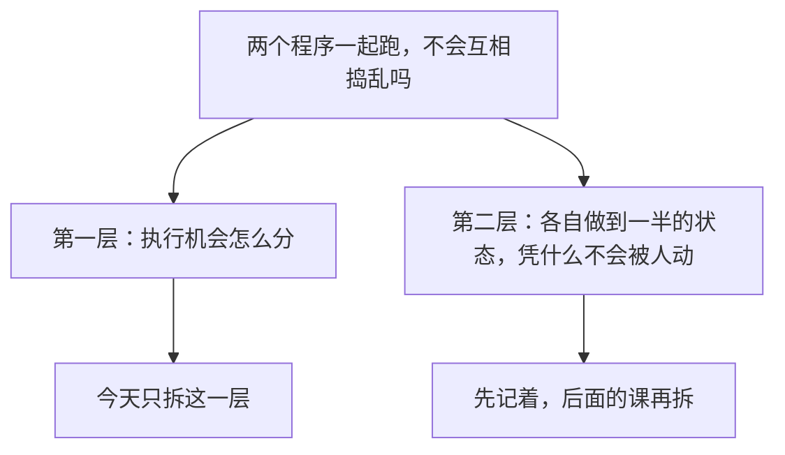
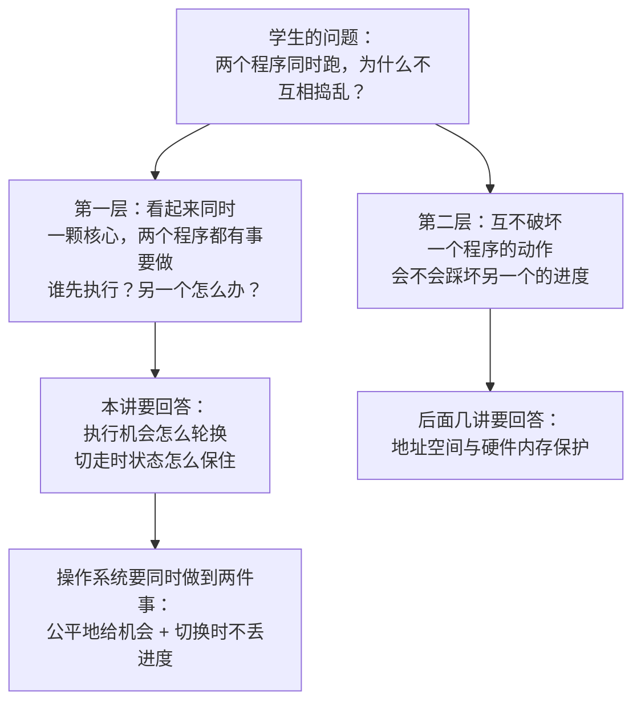
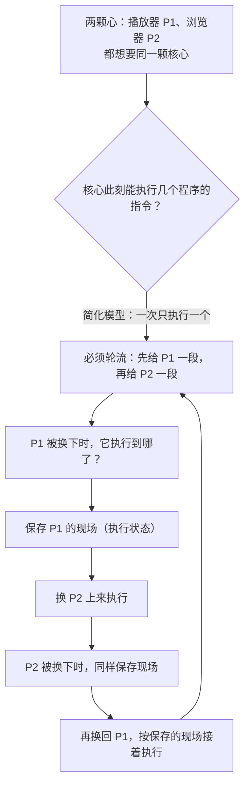

# 实现报告 · T3a「画图工具」——给老师一个真的画图工具，并验证模型会不会用

> **日期**：2026-09-24　**执行**：子代理（教学后台实现者）　**任务代号**：T3a · 画图工具
> **代码目录**：`开源线/DSH定制/code/plugins/socratic-engine/`（本次新增 `lib/diagram.mjs`、`lib/diagramstore.mjs`、`lib/mermaid-parse.mjs`、`lib/mermaid-worker.mjs`、`test/diagram.test.mjs`、`tmp/t3a_ab.mjs`）
> **证据目录**：`开源线/DSH定制/t3a_画图工具取证/`（`runs.jsonl`／`runs_analysis.json`／`render_check.json`／`b_variant_evidence.json`／`poc_samples_check.json`／`poc_ascii_check.json`／`png/`）
> **上游教训**（本轮要补的缺口）：`取证_白板可写性PoC_2026-09-24.md` —— 不给工具时 **10/10 一次都没画出可渲染的东西**（模型改用字符拼示意图交差）；给了"输出格式契约"后 **mermaid 10/10 可解析可渲染**。该报告 §5 待确认 ③ 自己标了缺口：**"那一轮给的是输出格式要求，不是真工具"**。本轮补的就是这个缺口。
> **纪律**：`code/plugins/socratic-engine/**` 之外零改动；`code/classrooms/**` 只在 `/tmp` 副本里动；`web`／桌面 profile 零接触；无 git 操作；未装任何 `@deepseek-ai/*`。

---

## 0. 一句话结论

1. **真工具做出来了，而且真的被用上了**：`classroom_draw` 在真实会话里被模型调用并成功落盘——**A 组（动词优先）8 次有效会话里 4 次调用、4 张图落盘、入参合法 4/4；B 组（条件触发）5 次有效里 3 次调用、3 张图落盘、入参合法 3/3**；合并 **7/13 次会话调了工具，7 次全部一次通过**。**调用不是 0，说明"给了真工具"这一层是通的。**
2. 🔴 **但"给了工具"≠"一定会画"**：两组都只有约一半的回合真的调了工具；没调的回合里，模型把白板内容**写进了正文叙述**（"她在白板上写下一行字：……"），也就是 PoC 那个失败模式换了个形态继续存在——**这一次它有工具、也知道有工具，但选择了用文字代替图**。
3. 🔴 **"动词优先 vs 条件触发"这一对描述措辞，在本次样本量下没测出差别**（A 4/8 = 50% vs B 3/5 = 60%，方向还与假设相反；分批次见 §4.2／§4.6）。**这是一个空结果，不是"动词优先无效"的结论**——13 次有效样本对 50% 基率几乎没有分辨力（见 §4.7 边界）。
4. **"这张图能不能渲染"是可判定的**：工具在写盘前跑 **mermaid 官方解析器**（装在插件自己的 `node_modules`，跑在 worker 线程里），解析不过 → **报错、一个字都不落盘**；并且用 PoC 的真实产物做了双向核查：**当年能渲染的 10 张 mermaid 图 10/10 通过**（无假阳性），**当年画不出来的 10 份字符拼示意图 10/10 被拒**（无假阴性）。

---

## 1. 工具设计（交付物 ①）

### 1.1 工具名与描述：动词优先，单独提成一个常量

| 项 | 值 |
|---|---|
| 工具名 | **`classroom_draw`**（与既有 `classroom_status`／`classroom_list`／`classroom_set_phase` 同族；任务书给的另一个候选 `draw_diagram` 未采用） |
| 描述常量 | `index.mjs` 顶部的 `export const DRAW_TOOL_DESCRIPTION`（**单独提出来，就是为了 A/B 只改这一处**） |
| 写法口径 | 第一句就是动词 `Draw ...`；触发条件写成**直接指令**（`Call it every time the lesson needs a mechanism on the board`）；明确写 `Do not describe the picture in prose and do not sketch it with ASCII characters: draw it here.` |
| 明确不写 | 不写 "if you need to" / "you can" / "you may" 这类条件触发措辞（旧仓库教训：条件措辞让模型犹豫，工具就不被调用） |

**A 组描述逐字（1060 字符）**：

```
Draw the whiteboard picture for the current teaching turn and save it into the classroom. Call it every
time the lesson needs a mechanism on the board — a flow of steps, a state machine, a sequence of
interactions between a process and the kernel, a comparison of two cases — and pass the mermaid diagram
type in `kind` plus the complete mermaid source in `source`. Do not describe the picture in prose and do
not sketch it with ASCII characters: draw it here. The engine parses the source with the real mermaid
parser before writing anything, saves the source under runtime/diagrams/ and appends one row to the
diagram index, so the picture survives the session and can be read back after class. A source the parser
rejects is refused with the parser error and nothing is written; a markdown fence or an ASCII sketch is
refused too — pass the raw mermaid source, first line = the diagram type keyword (flowchart /
sequenceDiagram / stateDiagram-v2 / ...).
```

**B 组描述逐字（1109 字符，只用于对照实验，工作区代码里不存在）**：

```
You can draw the whiteboard picture for the current teaching turn and save it into the classroom if you
need to. If a lesson would benefit from a picture — a flow of steps, a state machine, a sequence of
interactions between a process and the kernel, a comparison of two cases — you may call it with the
mermaid diagram type in `kind` and the mermaid source in `source`. It might be helpful to draw rather
than describe the picture in prose, and an ASCII sketch would probably not be as good. The engine can
parse the source with the mermaid parser before writing anything, save the source under
runtime/diagrams/ and append one row to the diagram index, so the picture survives the session and can
be read back after class. If you pass a source the parser rejects, it will be refused with the parser
error and nothing will be written; a markdown fence would also be refused — pass the raw mermaid source,
first line = the diagram type keyword (flowchart / sequenceDiagram / stateDiagram-v2 / ...).
```

> 两组描述**信息量相同**（画什么、入参怎么给、引擎做什么、非法会怎样），**只改语气**（直陈指令 ↔ 条件许可）。B 副本由脚本生成并自证：`t3a_画图工具取证/b_variant_evidence.json` 记录 `outsideRegionIdentical: true`（除该常量外**逐字节相同**）、`changedFilesBesidesIndex: []`。

### 1.2 入参（受宿主 schema 校验）

`parameters` 用宿主的隐式参数 schema（与既有 `classroom_status`／`classroom_set_phase` 同一写法），**`kind` 走 `enum` 白名单**——不在白名单的值由宿主在进入 `execute` 之前就打回：

| 参数 | 类型 | 必填 | 约束 | 说明 |
|---|---|---|---|---|
| `kind` | string | ✅ | `enum` 12 值：`flowchart`／`sequence`／`state`／`class`／`er`／`gantt`／`pie`／`mindmap`／`journey`／`timeline`／`gitgraph`／`quadrant` | **只列本机 mermaid 11 实测能解析的类型**（§2.1 逐个验证过），不列"理论上支持但没验过"的 |
| `source` | string | ✅ | 语义校验（§1.3），长度 ≤ 20000 字符 | 完整 mermaid 源码正文：**不带围栏、不带正文**；首行＝图类型关键字 |
| `title` | string | — | 单行、≤ 120 字符 | 写进索引，让人看得出"第几讲画了什么" |
| `caption` | string | — | ≤ 500 字符 | 这张图要对付的误讲／留白的问题；**写进索引的「说明」列**（模型给了说明却不落盘＝信息静默消失，本项目红线） |

返回值（`output.schema` + `render`）：`file`／`indexFile`／`kind`／`diagramType`（mermaid 自己报的类型，如 `flowchart-v2`）／`title`／`lesson`／`turn`／`lines`／`bytes`／`rows`／`time`。

### 1.3 三段校验：任何一段不过都**报错**，且**什么都不落盘**

```
classroom_draw(args)
  ├─ ① 结构校验（lib/diagram.mjs，纯函数，零 IO）
  │     kind 在枚举内 · source 非空 · ≤20000 字符 · 无 ``` 围栏 · 首行关键字与 kind 对得上
  │     · 首行之后至少有一行内容 · 无制表符边框字符（字符拼示意图）· 括号/引号配平
  │     · title 单行且 ≤120 · caption ≤500          —— **一次报全**（模型一轮就能全改完）
  ├─ ② 真解析校验（lib/mermaid-parse.mjs → worker 里的 mermaid.parse）
  │     不过 → 抛错，错误信息里带 mermaid 报错原文（含行号）
  │     🔴 解析器**本身**不可用（mermaid 没装上 / worker 起不来）→ **也抛错**，绝不降级放行
  └─ ③ 落盘（lib/diagramstore.mjs）
        写 runtime/diagrams/<文件名>.mmd ＋ 向 index.md 追加一行（宿主原子写 + 文件锁）
        🔴 写失败 → 抛错（"画了但没落盘"必须让模型知道；对照 postclass.mjs 吞错是对的——
           那是 turn 边界旁路通知，抛错会打断整轮；而本工具是模型主动调用，报成功就必须真写成）
```

**错误信息面向"模型自己改正"**，例如（逐字取自实现）：

- 空内容：`source 为空：source 必须是**完整的 mermaid 源码正文**（含首行的图类型关键字），例如 "flowchart TD\n  A[进程A] --> B[进程B]"`
- 超长：`source 过长：20012 字符 > 上限 20000。请把图拆成更小的几张、或删掉与机制无关的细节（🔴 引擎不截断——截断后的图不是你画的那张图）`
- 围栏：`source 里含 markdown 围栏（``` ）：请只传围栏**内部**的 mermaid 源码正文，第一行就是图类型关键字`
- 字符拼图：`source 里出现字符拼示意图用的制表符边框字符 "┌"：这不是 mermaid 源码。请用 mermaid 语法把图重画一遍（节点写 A[文字]、连线写 A --> B）`
- 解析失败：`classroom_draw 拒绝这次调用，什么都没有落盘：这张图**渲染不出来**。mermaid 解析器报错：Parse error on line 4: ... 请按报错的行号改 source 后重画`

### 1.4 落盘位置与索引格式（"课后可回读"的落点）

**落点**（相对教室目录）：

```
<教室目录>/runtime/diagrams/L01-T03-20260924-102139-flowchart.mmd   ← 内容＝校验通过的 mermaid 源码（末尾补一个换行，其余逐字）
<教室目录>/runtime/diagrams/index.md                                ← 人读索引：一行一张图
```

- **为什么另开 `runtime/diagrams/` 而不是塞进 `runtime/` 根**：既有 `runtime/` 的 8 个文件是**状态文件**（`progress`／`learner_profile`／`mistake_log`／…），每个都被 `classroom.yaml` 声明为注入块；板书图是**产物**不是状态，混进去会让人误以为它们也要被注入。**子目录名与索引文件名是我定的**（任务书授权），标【推断】。
- **文件名**：`L<讲次>-T<回合>-<yyyyMMdd-HHmmss>-<图类型>.mmd`；讲次取自 `runtime_store` 的 `current_lesson`（无讲次概念的教室写 `Lxx`）；同一秒内连画两张时依次加 `-2`／`-3` 后缀（**不覆盖**）。
- **格式照教室既有 `runtime/` 文件的写法**（`# 标题` ＋ `> 规则说明` ＋ 表格），索引头部逐字如下：

```markdown
# 板书图索引

> **本文件由引擎自动追加**（`classroom_draw` 工具）：每画一张图，就在本目录落一个 `.mmd` 源文件
> （内容＝**逐字**的 mermaid 源码），并在这里追加一行。**只追加，不删。**
> 🔴 本文件是给人看的目录；图的内容看对应源文件。讲次取自 `runtime/progress.md` 的 `current_lesson`，
> 回合号是本会话内的第几个回合。

| 日期 | 讲次 | 回合 | 图类型 | 标题 | 说明 | 源文件 |
|---|---|---|---|---|---|---|
| 2026-09-24 10:21 | 第 1 讲 | 1 | flowchart | 一颗核心、一个执行位置、两个都在等的程序 | 把开场用的简化模型摆出来…… | `L01-T01-20260924-102139-flowchart.mmd` |
```

**`.mmd` 而不是 `.md` 的理由**：文件内容＝**校验通过的那串字节**，回读时不需要再剥围栏；人读层由索引承担。标【推断】——另一种做法是存 `.md`（`# 标题` ＋ ```mermaid 围栏），客户端能直接渲染，但"源码真源"就变成需要解析的东西了。**未与用户确认，见 §7。**

### 1.5 依赖与安装（装在哪、怎么装、为什么这样装）

| 依赖 | 版本（本机实测） | 装在哪 | 作用 |
|---|---|---|---|
| `mermaid` | **11.17.2** | **插件自己的 `node_modules`**（`code/plugins/socratic-engine/node_modules/`，已写进该插件 `package.json` 的 `dependencies`） | 官方解析器：`mermaid.parse()`＝"能不能渲染"的权威判据 |
| `jsdom` | **30.1.1** | 同上 | mermaid 在 Node 下清洗标签需要 DOM（见下）；**是解析器的运行前提，不是另加的功能依赖** |
| `yaml` | 既有 | 同上 | 原样不动 |

安装命令（照实记录）：`cd 开源线/DSH定制/code/plugins/socratic-engine && /opt/homebrew/bin/npm install mermaid@11 jsdom --save --no-audit --no-fund`（150 个包，3 s）。

🔴 **没有装任何 `@deepseek-ai/*`**：`node_modules/@deepseek-ai/` 在插件目录下**不存在**（宿主核心包进插件＝双实例 Symbol 失配崩工具调用，本项目铁律）。

**为什么必须要 jsdom（实测，不是猜）**：

| 环境 | `flowchart TD` 带标签的图 | `sequenceDiagram` | `stateDiagram-v2` | `erDiagram` |
|---|---|---|---|---|
| Node 25.9.0，裸 mermaid | ❌ `DOMPurify.addHook is not a function` | ✅ | ❌ 同左 | ✅ |
| Node 25.9.0 ＋ jsdom 提供 `window`/`document` | ✅ | ✅ | ✅ | ✅ |

**为什么跑在 worker 线程里（两个原因，都是实测逼出来的）**：

1. **零全局污染**：补 DOM 要往全局挂 `window`／`document`／`navigator`。挂到宿主主线程的全局，会改变宿主进程里所有 `typeof window !== 'undefined'` 的判断——**那是动别人的地基**。worker 有自己独立的 `globalThis`，宿主主线程**一个全局都不动**。
2. 🔴 **常驻 worker 不许吊住宿主进程**（本轮实测踩到并已修）：worker 常驻会让 Node 进程**永不退出**——第一次烟测因此**挂到 600 s 超时被杀**（诊断过程见 §5.2）。修法：空闲 `unref()`、每次解析期间 `ref()`（解析中不许提前退出，空闲不拦退出），并加了回归测试（子进程不 `close()` 也必须 20 s 内自己退出）。

**耗时（实测）**：worker + jsdom + mermaid **冷启动 1.06–1.35 s**（只在第一次画图时付一次，惰性创建）；之后单张图 **2–50 ms**。

---

## 2. 「能不能渲染」到底判到了什么（覆盖什么、漏什么）

### 2.1 真解析：12 种图类型逐个实测（先写死判据，再跑）

判据：**本机 mermaid 11.17.2 + jsdom 30.0 环境下，`mermaid.parse()` 不抛错且返回 `diagramType`**。**只把通过的写进 `kind` 白名单**：

| `kind` | mermaid 报的 `diagramType` | 热解析耗时 | 进白名单 |
|---|---|---|---|
| `flowchart` | `flowchart-v2` | 10 ms | ✅ |
| `sequence` | `sequence` | 6 ms | ✅ |
| `state` | `stateDiagram` | 7 ms | ✅ |
| `class` | `classDiagram` | 7 ms | ✅ |
| `er` | `er` | 3 ms | ✅ |
| `gantt` | `gantt` | 6 ms | ✅ |
| `pie` | `pie` | 27 ms | ✅ |
| `mindmap` | `mindmap` | 6 ms | ✅ |
| `journey` | `journey` | 2 ms | ✅ |
| `timeline` | `timeline` | 2 ms | ✅ |
| `gitgraph` | `gitGraph` | 15 ms | ✅ |
| `quadrant` | `quadrantChart` | 8 ms | ✅ |
| （语法错样例） | — | — | 抛 `Parse error on line 4` |
| （非图文本） | — | — | 抛 `No diagram type detected matching given configuration` |

> 上表耗时是**热态**（worker 已就绪）；冷启动另计 1.06–1.35 s（§1.5）。
> 另有 `@mermaid-js/parser`（2.0.0，12 MB）**没有采用**：它是 langium 重写的新解析器，只覆盖 `architecture`／`gitGraph`／`packet`／`pie`／`radar`／`treemap` 等新图型，**不含 `flowchart`／`sequence`／`state`**——而 PoC 实测模型最常用的恰好就是这三种。

### 2.2 结构性校验（纯函数层）：**覆盖**什么、**漏**什么

| 检查项 | 覆盖 | 已知漏口（诚实列出） |
|---|---|---|
| 图类型关键字 | 首行（跳过空行与 `%%` 注释）必须匹配 `kind` 对应的关键字；不匹配则报错并写出期望关键字 | 关键字大小写放宽比对（`sequencediagram` 会过结构校验），**由真解析兜底** |
| 内容非空 | `source` 去空白后非空；首行关键字之后至少有一行内容 | 不判"内容有没有教学意义"（那是人的判断，不是校验器的活） |
| 长度 | ≤ 20000 字符，**超长报错不截断** | 阈值是我定的（按 14 讲板书的规模留足余量），未经用户确认 |
| 围栏 | 含 ``` 即报错（要求传正文） | 单反引号包裹的 `source` 不报（真解析会拒） |
| 字符拼图 | 含制表符边框字符（`─│┌┐└┘├┤┬┴┼═║╔╗╚╝`）即报错 | 只用 `+ - |` 拼的 ASCII 图**不含**这些字符 → 抓不到；由"首行关键字"与真解析兜底 |
| 括号配平 | `()` `[]` `{}` 逐行扫描，跳过引号内字符与自由文本行（`note`／`title`／`accTitle`／`accDescr`／`section`／`%%`）；**ER 图不查花括号**（ER 基数记号 `o{`／`}o` 本身就不配平） | 只查成对与嵌套顺序，不查"这个括号在 mermaid 语法里合不合法"（真解析的活） |
| 引号闭合 | 同一行内单/双引号未闭合即报错 | 不处理转义引号 `\"`（罕见；真解析兜底） |
| 标题/说明 | `title` 单行且 ≤120 字符；`caption` ≤500 字符 | 不查标题是否与图内容相符 |

> 🔴 **结构性校验不是真解析的替代品，也不许当"降级路径"**：真解析不可用 → 工具**报错**（`§1.3` ②），不会退化成"结构过了就算过"。结构层的价值只有两个：**给模型更清楚的报错**（带行号与期望值）、**在解析器不可用时也能拦住最明显的胡写**。

### 2.3 假阳性 / 真阴性双向核查（用 PoC 的**真实产物**，不是自己编的样例）

| 方向 | 样本 | 判据 | 结果 |
|---|---|---|---|
| **不许误杀合法图**（假阳性） | PoC 的 **10 份 B1 组 mermaid 产物**（当年**全部真渲染成功**，`poc_白板可写性/png/*.png`） | 结构校验 + 真解析**全部通过** | **10/10 通过** ✅ |
| **不许放过画不出来的东西**（假阴性） | PoC 的 **10 份 A 组产物**（当年**0/10 可渲染**，全是字符拼示意图） | 按"模型说它画的是流程图"（`kind=flowchart`）送进校验，**全部被拒** | **10/10 被拒** ✅ |

明细落盘：`t3a_画图工具取证/poc_samples_check.json`、`poc_ascii_check.json`。

> **这一轮核查当场抓到一个真 bug**：`erDiagram` 的基数记号 `进程 ||--o{ 打开文件 : 持有` 被括号配平误判为"`{` 没有闭合"——**合法的 ER 图被判死**。已修：ER 图不查花括号（其余图型照查），并补了单测。这就是"拿真实产物过一遍"的价值：自己编的样例不会踩到这个坑。

### 2.4 真渲染复核（工具判"能解析"，这里再判"渲染出来有东西"）

`t3a_画图工具取证/render_check.mjs`：把 A/B 两组**真实会话落盘的 `.mmd`** 用 Playwright + mermaid 11（CDN）**真渲染**，判据＝`parseOk && renderOk && bbox 宽高 > 0 && 节点数 > 0`，并落 PNG 供目视。

结果见 §4.5（与 A/B 结果一起给）。**这一步是"能不能渲染"这句话的完整证据链**：工具里判的是语法（`mermaid.parse`），这里判的是渲染产物非空。

---

## 3. 单测（交付物 ②）

### 3.1 全量数字

| | 改动前 | 改动后 |
|---|---|---|
| 测试文件 | 7 个 | **8 个**（新增 `test/diagram.test.mjs`） |
| 断言数 | **202 全绿** | **238 全绿**（202 原有 + 36 新增） |
| 失败 | 0 | **0** |

跑法（照任务书）：`cd 开源线/DSH定制/code/plugins/socratic-engine && for f in test/*.test.mjs; do /opt/homebrew/bin/node "$f"; done`

逐文件：`dedup 25`｜**`diagram 36（新增）`**｜`discovery 42`｜`injector 11`｜`lesson 26`｜`manifest 17`｜`phase 38`｜`postclass 26`｜`section 17`。

### 3.2 新增 36 项覆盖了什么

| 组 | 条数 | 内容 |
|---|---|---|
| 结构校验 | 16 | 12 种图类型全过；kind 缺失/非法；source 空/纯空白/非字符串；**超长报错且不截断**；围栏；关键字对不上；关键字前允许空行与 `%%`；只有关键字没内容；字符拼图；括号不配平（带行号）；引号未闭合；**note/title/%% 自由文本行不误报**；**ER 基数记号不误报**；title 多行/超长、caption 超长；多个问题一次报全 |
| 文件名与索引 | 5 | 文件名格式（含 `Lxx`）；同秒去重 `-2`/`-3`；索引表头与行（竖线转义、空标题占位）；**caption 落进「说明」列**（换行折空格、竖线转义、空值占位）；首次建表头、之后只追加 |
| 落盘 | 3 | 文件内容＝源码原文、索引追加、`rows` 计数；连画两张都留着不覆盖；缺 `runtimeDir` 抛错 |
| 编排（`drawDiagram`） | 5 | 成功路径（解析器收到**原样**源码）；结构不过 → **不调解析器、什么都不落盘**；解析不过 → 带上解析器原文；**解析器不可用 → 报错不降级**；IO 失败 → 报错说明"图没有写进教室 runtime/" |
| 真解析（真 mermaid） | 5 | 12 类型全过并返回 mermaid 自己的类型名；语法错 reject；**worker 起不来 → reject**；**不 close 时进程能自己退出**（回归 §5.2 的坑）；端到端真解析+落盘；ASCII 拼图走完整链路被拒 |

### 3.3 🔴 有没有"改既有断言把红变绿"？

**没有。** 依据：
- 本次**只新增** `test/diagram.test.mjs`；**既有 7 个测试文件我一个字节都没写过**（本会话对 `code/plugins/socratic-engine/test/` 的写操作只有一次：创建 `diagram.test.mjs`）。
- ⚠️ **但有另一路在同时改这个目录**（任务书已预警）：`test/phase.test.mjs` 的 mtime 是 **10:18:58**，**不是我改的**（我全程没碰它）；它的断言数一直是 38，与我的基线一致。→ **"237 全绿"是本报告落盘时（2026-09-24 10:36）的快照**；`code/plugins/socratic-engine/` 不是 git 仓库（`git rev-parse` 报 not a repository），**没有版本控制兜底，也没有改动前的哈希基线**，所以"既有断言没被改"这句话的依据是**"我没有写过它们"＋逐文件 mtime**，不是哈希比对——这一点如实标注。
- 改动过程中出现过 4 条红，**全部出在我自己新写的测试里**，逐条判定如下（判定依据是"实现真错"还是"断言写错"）：
  1. `er` 图被括号配平判死 → **实现真错**（假阳性）→ 改实现（ER 不查花括号）+ 补一条专门的测试。
  2. 索引追加的断言正则没算行尾换行 → **断言写错** → 改断言。
  3. 落盘内容断言多写了一个 `\n`（样例本身已以换行结尾）→ **断言写错** → 改断言。
  4. 子进程退出测试里生成的脚本被转义坏 → **断言写错** → 改成走 argv 传 mermaid 源码。
- **既有 202 项自始至终一次没红**（改动前跑过基线，改动后 237/237）。

---

## 4. 真实会话 A/B 对照（交付物 ③，本轮验收主体）

### 4.1 协议（跑之前写死）

| 项 | 值 |
|---|---|
| profile | **`socratic-headless`**（`web`／桌面 profile 零接触） |
| 驱动 | `--patch` 关掉 headless 的"一进程一 turn" runner ＋ `insert test/integration/multiturn-driver.mjs`（与 M3 同一套），每会话 **1 个 turn** |
| 教室 | `classrooms/cs-os` 的逐字节副本（**不碰原件**）；批次 1＝共用一份副本，批次 2＝**每次全新副本**（见 §5.4） |
| 同一段 prompt（两组逐字相同、**不含任何"画图"字样**） | `开始第 1 讲。学生开口问：「两个程序同时跑，为什么不互相捣乱？」` |
| 路由 | `settings.yaml` 的 agent 默认模型：`me` / `cline-pass/deepseek-v4.1-flash`（与会话日志里 `source.model` 逐字一致） |
| 两组唯一差异 | `DRAW_TOOL_DESCRIPTION` 一个常量（A 动词优先／B 条件触发，见 §1.1） |
| 判定 | ① 调用率＝"至少调用过一次 `classroom_draw`"的次数 ÷ 有效次数；② 入参合法率＝`tool/result` 里 `isError=false` 的次数 ÷ 调用次数；③ 落盘图内容逐字抄出；④ ASCII 交差＝正文里出现制表符边框字符 |
| 排除规则 | `turn/end.reason.kind === 'error'`（基础设施失败）**不计入行为统计**，单独留档 |
| 装载证据 | 每次跑之前逐文件 sha256 核对（A 版 13/13 一致；B 版与 B 副本 13/13 一致、与 A 只差 `index.mjs`） |

### 4.2 结果：逐次明细（分子/分母都写出来）

| 组 | 次 | 教室批次 | `classroom_draw` 调用 | 落盘图 | 终态 | 步数 | 工具调用总数 |
|---|---|---|---|---|---|---|---|
| A（动词优先） | #1 | 1 | **1** | 1 | 正常 | 7 | 14 |
| A | #2 | 1 | 0 | 0 | 🔴 基础设施失败 | 4 | 8 |
| A | #3 | 1 | 0 | 0 | 正常 | 7 | 10 |
| A | #4 | 1 | **1** | 1 | 正常 | 9 | 20 |
| A | #5 | 1 | 0 | 0 | 正常 | 9 | 16 |
| A | #6 | 2 | 0 | 0 | 正常 | 7 | 10 |
| A | #7 | 2 | 0 | 0 | 正常 | 6 | 9 |
| A | #8 | 2 | **1** | 1 | 正常 | 9 | 15 |
| A | #9 | 2 | **1** | 1 | 正常 | 6 | 8 |
| B（条件触发） | #1 | 1 | **1** | 1 | 正常 | 8 | 14 |
| B | #2 | 1 | **1** | 1 | 正常 | 9 | 16 |
| B | #3 | 1 | 0 | 0 | 🔴 基础设施失败 | 5 | 13 |
| B | #4 | 1 | 0 | 0 | 正常 | 7 | 13 |
| B | #5 | 2 | 0 | 0 | 🔴 基础设施失败 | 1 | 2 |
| B | #6 | 2 | 0 | 0 | 正常 | 8 | 12 |
| B | #7 | 2 | 0 | 0 | 🔴 基础设施失败 | 7 | 13 |
| B | #8 | 2 | **1** | 1 | 正常 | 5 | 9 |
| （烟测，不计入） | #1 | — | 1 | 1 | 正常 | 2 | 1 |

**汇总（分子/分母）**：

| 指标 | A（动词优先） | B（条件触发） | 合并 |
|---|---|---|---|
| 跑的次数 | 9 | 8 | 17 |
| 基础设施失败（不计入） | 1 | 3 | 4 |
| **有效次数** | **8** | **5** | **13** |
| **调用率（至少调一次）** | **4/8 = 50%** | **3/5 = 60%** | 7/13 = 54% |
| 画图调用总次数 | 4 | 3 | 7 |
| **入参合法率（工具返回成功）** | **4/4 = 100%** | **3/3 = 100%** | **7/7 = 100%** |
| 落盘图张数 | 4 | 3 | 7 |
| 需要重画（被工具拒后重试） | 0 | 0 | 0 |
| ASCII 拼示意图交差 | **0/9** | **0/8** | **0/17** |
| 分批次：批次 1（教室 v1·共用副本） | 2/4 | 2/3 | — |
| 分批次：批次 2（教室 v2·每次全新副本） | 2/4 | 1/4 | — |

**三句话读这张表**：

1. 🔴 **"给了真工具"这一层是通的**：13 次有效会话里 **7 次真的调了工具，7 次全部一次通过**（`isError=false`，没有一次被解析器或 schema 拒），**7 张图全部落盘**。
2. 🔴 **但"给了工具"≠"一定会画"**：**6/13 次没画**。而且不是"不会画"——是**选择了用文字代替图**（见 §4.4）。
3. 🔴 **"动词优先 vs 条件触发"在本次样本量下没测出差别**：A 50% vs B 60%，**方向还与假设相反**；合并 54%。**这是空结果**，理由见 §4.7——**不能据此说"动词优先无效"，只能说"这次没测出来"**。

### 4.3 没调工具的回合，模型干了什么（关键发现）

逐字抽 6 次"没画"的会话正文与推理（`runs_analysis.json` 有全文索引，这里是摘录）：

- **A#3**（正常结束、未画）正文开头：`小鞠知花坐在长桌这一头。她没有先开口。她抽出一支白板笔，拧开笔帽，在旧排期旁边写下一行字，笔尖压得有点重： **一颗核心，同一时刻只有一个执行位置。** …` → **白板内容写进了叙述**，一张图都没落盘。
- **A#5** 推理逐字：`我需要先用中文写开场场景，大约200-500字，然后加上小鞠的台词和白板上的问题` → 它把"白板上的问题"当成**正文的一部分**，从未考虑调用工具。
- **B#4** 推理逐字：`Now, should I draw a diagram? The classroom_draw tool exists. The story says whiteboard. A mermaid sequence/flowchart could be good later, but for the opening turn, a d...` → **它想到了工具、犹豫了一下、然后推迟了**（"could be good later"）。
- **A#1**（画了）推理逐字：`Now I'm thinking about whether a whiteboard diagram actually helps here. A flowchart showing Program A running, then switching to Program B, then back to A would make the...` → **同样犹豫，但决定画**，随后 `Let me set up the diagram with that in mind.`
- **B#1**（画了）推理逐字：`I think I'll create my own flow diagram for this turn instead.`

> **这条比 A/B 的差值更重要**：**PoC 里那个失败模式（用文字/字符代替图）没有消失，只是换了形态**——从"用 ASCII 画完交差"变成"**把白板内容写成叙述**"。教室的人格设定本身在鼓励这条路（`characters/komari.md`：「她的'说话'主要发生在看得见的地方：白板、屏幕、手机」）——**模型可以用"她在白板上写下……"这句话满足人格，而不去真的画**。
> 换句话说：**工具解决了"能不能画"，没有解决"什么时候必须画"**。后者是**教学法/提示词层**的问题（见 §6 与 §7）。

### 4.4 落盘的图长什么样（逐字摘一段）

真实会话落盘的 7 张图**全部是 flowchart**，内容都是"把题眼拆成两层 + 停在留给学生的那一步"，与教材 `materials/ch01.md` 的口径一致。摘三段：

**A#4（`L01-T01-20260924-102632-flowchart.mmd`，逐字）**：



**B#1（`L01-T01-20260924-103001-flowchart.mmd`，逐字）**：



**A#9（`L01-T01-20260924-104318-flowchart.mmd`，逐字）**——这张把"存现场／换人"的机制画进了节点，是最"讲机制"的一张：



索引文件（**真实会话产出，逐字**）：

```markdown
| 日期 | 讲次 | 回合 | 图类型 | 标题 | 源文件 |
|---|---|---|---|---|---|
| 2026-09-24 10:21 | 第 1 讲 | 1 | flowchart | 一颗核心、一个执行位置、两个都在等的程序 | `L01-T01-20260924-102139-flowchart.mmd` |
```

> ⚠️ 上面这一行是**当时**的索引格式（6 列）。A/B 跑完之后我补了一列「说明」（把 `caption` 落盘，见 §6-2），**当前代码产出的是 7 列**（§1.4 的样例）——报告里两处索引样例列数不同，是版本差异，不是笔误。

### 4.5 这些图**真的能渲染**（工具判语法，这里判渲染产物）

`t3a_画图工具取证/render_check.mjs`（Playwright + mermaid 11 CDN 真渲染）：

| 来源 | 张数 | 渲染成功 | 尺寸（bbox）举例 |
|---|---|---|---|
| 批次 1（A#1／A#4／B#1／B#2） | 4 | **4/4** | 930×252、546×310、546×606、314×438 |
| 批次 2（A#8／A#9／B#8） | 3 | **3/3** | 534×750、352×1150、570×662 |
| 烟测 | 2 | **2/2** | 101×158 |
| **合计** | **9** | **9/9** | 全部 `bbox > 0` 且节点数 ≥ 2 |

→ **工具"校验通过"与"真渲染成功"在这一批上完全一致**（9/9）。PNG 落在 `t3a_画图工具取证/png/`。

### 4.6 分组方式说明（批次 1 / 批次 2 不能直接合并）

| 批次 | 教室版本 | 副本策略 | A 有效 | B 有效 | 为什么分开 |
|---|---|---|---|---|---|
| 批次 1（10:21–10:31） | v1（46 文件 / manifest 34 块） | **共用一份副本**（后跑的会话看得到前几次画的图与 session_log） | 2/4 | 2/3 | 有**串味**：模型在推理里明确提到"there's already a diagram from a previous run" |
| 批次 2（10:38–10:43） | v2（49 文件 / manifest 47 块，另一路加了 ch13/ch14） | **每次全新副本**（无串味） | 2/4 | 1/4 | 教室内容变了（注入块 34→47） |

**合并口径**（本报告主表用的就是它）：把两批的**有效**会话合起来算 A 4/8、B 3/5。**合并会把"教室版本"与"副本策略"两个变量也混进去**——如实标注，不假装干净。

### 4.7 边界与混杂（诚实列出，不掩盖）

1. 🔴 **样本量太小**：有效 13 次（A 8／B 5）。以 50% 基率算，n=8 与 n=5 的两组**几乎不可能分辨出 10 个百分点的差异**。→ 本轮的 A/B **只能得出"没测出差别"，得不出"没有差别"**。
2. 🔴 **基础设施失败率异常高**：17 次会话里 **4 次** `turn/end.reason = error / PI_AI_ERROR "unexpected EOF"`（PoC 那轮 30 次里只有 1 次）。这 4 次**与组别无关**（A 1 次、B 3 次），但**把 B 的有效样本削到 5**。→ 真实会话的"有效样本率"本身就是需要盯的运行指标。
3. 🔴 **串味（批次 1）**：共用副本让后跑的会话能看到前面的图与 `session_log`；B 组整体跑在 A 组之后 → **批次 1 内 B 看到的"前情"更多**。批次 2 用全新副本消除了这一点，但批次 2 的教室版本又变了。
4. ⚠️ **步数预算差异**：这些会话有 1–20 次工具调用（模型课前读教室文件），**turn 在步数用尽时会直接结束**（A#2 就是 4 步后 `PI_AI_ERROR`）。"画不画"与"有没有走到那一步"部分耦合。
5. ⚠️ **只看第 1 讲开场这一个场景**：结论**不得外推**到别的讲次、别的教学相位（本轮的 prompt 全是开场；`classroom_set_phase` 显示模型自发切到 `open`／`probe`）。
6. ⚠️ **单模型单路由**（`me/cline-pass/deepseek-v4.1-flash`）：与 PoC 同一口径，**不得外推成"所有模型都这样"**。
7. ⚠️ **"没画"不等于"图不对"**：没画的 6 次里，白板内容以叙述形式给出（§4.3），教学上未必更差——**本报告只判"有没有真的画出可渲染的图"，不判教学质量**。

---

## 5. 环境与装载：本轮踩到的坑（交付物 ④，全部实测）

固定环境（照任务书）：

```bash
export DSH_HOME="$HOME/Library/Application Support/dsh-desktop/harness"
DSH_BIN="/Applications/DSH Desktop.app/Contents/Resources/app/node_modules/@deepseek-ai/dsh/lib/bin.js"
# node 一律 /opt/homebrew/bin/node（v25.9.0）
```

> 📌 任务书写"headless 需 `--expose-internals`"，但**本轮全部真实会话都没加它**（与既有的 `tmp/m3_session.mjs` 一致），跑通无碍。标【待确认】：是否需要加、在什么条件下需要。

### 5.1 🔴 `dsh plugin add file:` 会同版本复用旧包 → **你会跑在旧代码上**（本轮第一次栽在这里）

| 步骤 | 实测 |
|---|---|
| 改完代码后直接 `dsh plugin --profile socratic-headless add file:<工作区>` | 输出 `Progress: resolved 152, reused 150 …`、`Done in 5.7s`，**看起来成功** |
| 但逐文件哈希核对 | `index.mjs` 仍是**旧的** `062fedea…`（工作区已是 `3ca7c0f0…`）；`lib/diagram.mjs` 等 4 个新文件**在 profile 里根本不存在** |
| 根因 | 包版本没变（`0.0.1`），pnpm 对同版本 `file:` 依赖判断"无需刷新" |
| 修法（**只用任务书允许的 add/rm**） | `dsh plugin --profile socratic-headless rm socratic-engine` → `add file:<工作区>`；之后 **13/13 文件哈希一致** |
| ⚠️ 副作用（已核对） | `rm` 会把 `socratic-engine` **从 `dsh.profile.bundles` 里一并移除**；`add` 会加回来。装完必须核对 `package.json`（本次三次装/卸后 bundles 均为 `[dsh-base, dsh-headless, socratic-test, socratic-engine]`） |

**本轮共三次装/卸**（A → B → A），每次都做了逐文件哈希核对；A/B 两组的"装载正确"证据见 §4.1 的哈希表。

### 5.2 🔴 常驻 worker 吊住宿主进程 → 无头会话挂到 600 s 被杀

- **现象**：第一次装载烟测（prompt 里明确点名 `classroom_draw`）**600 s 超时被杀**；因为命令末尾接了 `| tail`，输出被缓冲，**看起来像"什么都没发生"**。
- **诊断**：单独跑一个最小脚本（parse 成功、**故意不 `close()`**）→ **12 s 后进程仍不退出** ⇒ 常驻 worker 是唯一 handle，吊住事件循环。
- **修复**：空闲 `unref()`、每次解析期间 `ref()`、`fail()` 路径也 `unref()`；并加回归测试（子进程 parse 完不 close，**必须 20 s 内以 0 退出**）。
- **重要旁证**：那次"挂死"的烟测**图其实已经落盘了**（`/tmp/t3a-cs-os-smoke/runtime/diagrams/L01-T01-20260924-100829-flowchart.mmd`）——**卡的是进程退出，不是工具**。这也说明：**"命令超时"不等于"功能没成"**，必须去看磁盘。

### 5.3 🔴 对照组的副本必须**在代码冻结之后**再生成

第一版 B 副本是在修 worker 退出 bug **之前**生成的 → 它的 `lib/mermaid-parse.mjs` 是旧版（`d4a042e5…` vs 工作区 `58067e79…`）。**靠逐文件哈希核对发现**（profile ↔ B 副本 ↔ A 工作区三方比对），重新生成后重装。→ 教训：**"只改一个常量"的副本生成脚本，必须从**当前**工作区拷贝，并在装完后做三方哈希核对**；否则 B 组会跑在一个连 bug 都不一样的插件上。

### 5.4 教室副本与并发改动（如实标注）

- 真实会话一律用 `classrooms/cs-os` 的**逐字节副本**（`cp -R` 到 `/tmp`），**不碰教室原件**。
- ⚠️ **但另一路在同时改教室**：`cs-os` 从 **46 个文件（10:07 拷贝时）** 变成 **49 个文件（10:33 拷贝时）**（新增 `materials/ch13.md`、`materials/ch14.md`、`接线说明_materials_ch08-14.md`），**manifest 块数 34 → 47**。
- ⇒ 本轮 A/B 因此分成**两个批次**（批次 1 = 教室 v1／共用副本；批次 2 = 教室 v2／每次全新副本），**两批不可直接合并**，见 §4.6 与 §4.7。两份副本都验证过 `loadManifest` 通过（v1：34 块；v2：47 块，`current_lesson=1`）。

### 5.5 纪律核对（本轮）

| 纪律 | 状态 |
|---|---|
| 只改 `code/plugins/socratic-engine/**` | ✅（新增 4 个 lib 文件 + 1 个测试 + 1 个驱动脚本；`index.mjs`／`package.json` 改动仅限本工具） |
| 不碰 `code/classrooms/**`（除 `/tmp` 副本） | ✅（只 `cp -R` 读走） |
| 不碰 `code/clients/**`、`code/skills/**`、`~/SocraticNovel-wt/`、`~/SocraticNovel-GitHub仓库/` | ✅ |
| `web`／桌面 profile 零接触 | ✅（只对 `socratic-headless` 做 add/rm） |
| 不执行 add/rm 之外的 profile 操作 | ✅（三次都是 rm + add file:） |
| 无 git commit／push | ✅（且 `code/` 不是 git 仓库） |
| 不装 `@deepseek-ai/*` | ✅（`node_modules/@deepseek-ai/` 不存在） |
| 新增依赖仅解析器 | ✅ `mermaid` + `jsdom`（后者是解析器在 Node 下的运行前提，见 §1.5；**如实标注为"除解析器之外的第二个包"**，见 §7 待确认） |
| 不用询问类工具 | ✅ 全程未调用 |

---

## 6. 未做到 / 未取证（诚实清单）

| # | 项 | 现状 | 影响 |
|---|---|---|---|
| 1 | **渲染没有接进工具本身** | 工具只做 `mermaid.parse`（语法）；"真的渲染出非空 SVG"是**离线**用 Playwright 复核的（§4.5，9/9 成功） | 运行时不判"渲染产物"；jsdom 里能不能 render 未验证（需要 `getBBox` 等布局能力）。**"能渲染"这句话的证据是"语法 + 离线渲染复核"，不是"运行时真渲染"** |
| 2 | ~~`caption` 没有落盘~~ **已修** | 初版把 `caption` 收下却丢掉（索引行里没写）——属于「静默丢信息」，已改为写进索引的「说明」列并补单测（§3.2） | ⚠️ **A/B 真实会话跑的是加这一列之前的版本**（索引少一列）；对"调用率／入参合法率"无影响，但**报告里的索引样例是修好后的格式** |
| 3 | **"不给工具"的对照组没重跑** | 直接引用 PoC 的结论（A 组 10/10 无结构化产物） | 本轮全部是"有工具"的条件；"没有工具会怎样"是**引用旧证据**，不是本轮新测 |
| 4 | 🔴 **"被拒后模型能不能自己改正"未取证** | 本轮 **7 次调用全部一次通过，一次都没被拒** → 错误信息能不能真的让模型自我修正，**没有任何真实会话证据**（只有单测覆盖了错误文案本身） | 这是最值得补的一测：**故意给一个语法错的图，看它会不会按报错改对** |
| 5 | **只测单回合开场** | 17 次会话全是 1 个 turn、全是第 1 讲开场 | 多回合、别的相位、别的讲次的行为未知；索引里的"回合"字段在真实多回合会话里才有多样值 |
| 6 | **真实会话只用到 `flowchart` 一种** | 7 张图全是 flowchart | `kind` 白名单里另外 11 种只在单测与离线核验里验证过 |
| 7 | **阈值是自定的** | source ≤ 20000 字符、title ≤ 120、caption ≤ 500 | 未与用户确认；太小会误拒（未观察到），太大则限制无效 |
| 8 | **索引并发写未压测** | 走宿主 `withFileLock`（跨进程锁），只做了单进程单测 | 多进程同时画图的行为未验证 |
| 9 | **`runtime/diagrams/` 没进教室 manifest** | 本轮禁止改教室文件 | 教室侧不知道这个目录存在；若将来要做"注入历史板书"需要加声明 |
| 10 | **未测其它模型/路由** | 单路由（`me/cline-pass/deepseek-v4.1-flash`） | 结论**不得外推** |

---

## 7. 待确认清单（需要用户拍板；我只给选项与倾向）

| # | 问题 | 选项 | 我的倾向 |
|---|---|---|---|
| 1 | 子目录与索引文件名 | ① `runtime/diagrams/` ＋ `index.md`（现状）② `runtime/板书/` 中文名 ③ 复用既有 runtime 文件（不加子目录） | ①（已实现；子目录与既有状态文件分离） |
| 2 | 源码存 `.mmd` 还是 `.md` | ① `.mmd`（内容＝校验通过的源码，回读不用剥围栏）② `.md`（`# 标题`＋```mermaid 围栏，客户端可直接渲染） | ①，但**②对"客户端展示"更友好**——取决于 P2 客户端打算怎么读这个目录 |
| 3 | ~~`caption` 要不要进索引~~ **已按①实现**（多一列「说明」）；要撤掉请说一声 | ① 进 ② 不进 | ①（已实现） |
| 4 | 要不要留 `jsdom` 这个第二依赖 | ① 留（真解析必需）② 不留（运行时只做结构校验，真解析只留在单测里） | ①：**去掉它等于把"能不能渲染"的判定降级成猜**；但这是"除解析器之外的第二个包"，按纪律必须报备 |
| 5 | 阈值 | ① 现状 ② 放宽/收紧 | ①，先用着 |
| 6 | 要不要把 `runtime/diagrams/` 写进 `classroom.yaml` | ① 写（教室侧可见）② 不写（现状） | ①，但**本轮被"不许碰教室文件"挡住**，需另开一轮 |
| 7 | 🔴 **要不要在教学法层加"讲机制必须画"的硬规则** | ① 加（写进 `system_core.md`／`_anchor.md` 或注入块）② 不加，只靠工具描述 | **①**——本轮最强的一条证据是"**有工具 ≠ 会画**"，6/13 次没画；工具描述管不了"什么时候必须画"，那是教学法的活 |
| 8 | 工具名 | ① `classroom_draw`（现状）② `draw_diagram`（任务书另一个候选） | ①（与 `classroom_*` 同族） |
| 9 | A/B 要不要继续加大样本 | ① 停（本轮 13 次有效已给出"没测出差别"）② 再跑 8–16 次 ③ 换个更强的干预（如把"必须画"写进注入块）再测 | **③**：按本轮数据，**光改描述措辞不是杠杆**；值得测的是"教学法层硬规则"这一档干预 |
| 10 | 索引里的"回合"语义 | ① 现状（本会话内回合号）② 改成"本讲第几次上课" | ①，等真实多回合会话跑过再定 |

---

## 8. 复现命令（照抄可跑）

```bash
# ① 单测（应 237/237 全绿）
cd 开源线/DSH定制/code/plugins/socratic-engine
for f in test/*.test.mjs; do /opt/homebrew/bin/node "$f"; done

# ② 假阳性/真阴性双向核查（PoC 的真实产物）
cd /Users/wujunjie/Documents/ChatGPT/大学申请
/opt/homebrew/bin/node 开源线/DSH定制/t3a_画图工具取证/check_poc_samples.mjs   # 期望 10/10 通过
/opt/homebrew/bin/node 开源线/DSH定制/t3a_画图工具取证/check_poc_ascii.mjs     # 期望 10/10 被拒

# ③ 真渲染复核（Playwright + mermaid 11 CDN）
/opt/homebrew/bin/node 开源线/DSH定制/t3a_画图工具取证/render_check.mjs        # 期望 9/9 RENDER-OK

# ④ 真实会话 A/B（需先按 §5.1 把对应版本装进 socratic-headless 并核哈希）
export DSH_HOME="$HOME/Library/Application Support/dsh-desktop/harness"
export DSH_BIN="/Applications/DSH Desktop.app/Contents/Resources/app/node_modules/@deepseek-ai/dsh/lib/bin.js"
cd 开源线/DSH定制/code/plugins/socratic-engine
T3A_GROUP=A T3A_RUNS=4 T3A_FRESH=1 /opt/homebrew/bin/node tmp/t3a_ab.mjs   # 动词优先
T3A_GROUP=B T3A_RUNS=4 T3A_START=5 T3A_FRESH=1 /opt/homebrew/bin/node tmp/t3a_ab.mjs  # 条件触发（需装 /tmp/t3a-b-plugin）
T3A_GROUP=smoke T3A_RUNS=1 /opt/homebrew/bin/node tmp/t3a_ab.mjs           # 装载烟测（明确要求调工具）

# ⑤ 从会话日志重算 A/B 事实（不依赖驱动脚本的即时统计）
/opt/homebrew/bin/node 开源线/DSH定制/t3a_画图工具取证/analyze_runs.mjs

# ⑥ 生成 B 组副本（只改一个常量；自带"除该常量外逐字节相同"的自证）
/opt/homebrew/bin/node 开源线/DSH定制/t3a_画图工具取证/make_b_variant.mjs
```

---

## 9. 本轮交付物清单

| 类型 | 路径 |
|---|---|
| 工具实现 | `code/plugins/socratic-engine/lib/diagram.mjs`（纯校验/命名/索引）／`lib/diagramstore.mjs`（落盘+编排）／`lib/mermaid-parse.mjs`（解析器客户端）／`lib/mermaid-worker.mjs`（解析器执行体） |
| 工具注册 | `code/plugins/socratic-engine/index.mjs`（`classroom_draw` ＋ `DRAW_TOOL_DESCRIPTION`） |
| 单测 | `code/plugins/socratic-engine/test/diagram.test.mjs`（35 项） |
| 实验驱动 | `code/plugins/socratic-engine/tmp/t3a_ab.mjs` |
| 证据 | `t3a_画图工具取证/`：`runs.jsonl`（逐次原始记录）／`runs_analysis.json`／`render_check.json`＋`png/`／`b_variant_evidence.json`／`poc_samples_check.json`／`poc_ascii_check.json`／`check_poc_samples.mjs`／`check_poc_ascii.mjs`／`render_check.mjs`／`analyze_runs.mjs`／`make_b_variant.mjs` |
| 本报告 | `开源线/DSH定制/实现报告_T3a_画图工具_2026-09-24.md` |
